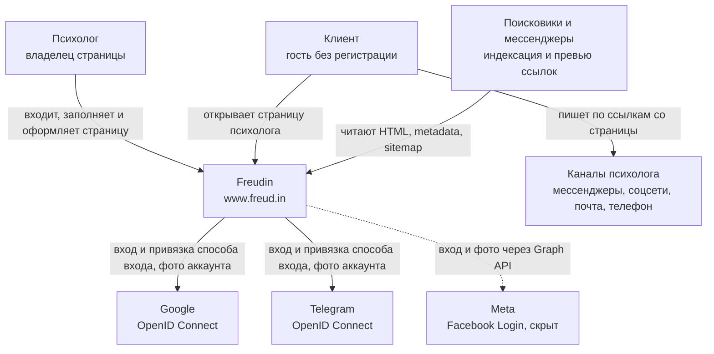

# Контекст системы — Freudin

Уровень **L1 — System Context** C4-модели. Показывает Freudin целиком: кто им пользуется
и с какими внешними системами он связан. Из чего состоит система — в [контейнерах](2.containers.md),
внутреннее устройство — в [компонентах](3.components.md) и [деталях кода](4.code.md).
Сценарии взаимодействия — в [динамических представлениях](dynamic.md).
О продукте — [`docs/PRODUCT.md`](../PRODUCT.md).

## Система

**Freudin** (`www.freud.in`) — сайт, где психолог делает личную страницу-визитку `/<username>`,
а клиент без регистрации находит психолога и связывается с ним напрямую. Сайт — минимальный
посредник: не проверяет психологов, не участвует в общении и не берёт оплату.

## Пользователи

| Кто | Что делает в системе | Вход |
|---|---|---|
| **Психолог** | Создаёт страницу в онбординге, редактирует её в `/settings` (данные практики, FAQ, услуги, документы, оформление), скрывает страницу или ставит пароль, делится ссылкой и QR-кодом, удаляет аккаунт | Google или Telegram; к аккаунту можно привязать несколько способов |
| **Клиент** | Открывает `/<username>`, читает страницу, переходит по контактам психолога. Скрытую страницу открывает паролем | Нет |
| **Поисковики и мессенджеры** | Индексируют личные и юридические страницы, строят превью ссылки по Open Graph | Нет |

## Внешние системы

| Система | Связь | Зачем |
|---|---|---|
| **Google** | Freudin ↔ Google OIDC | Вход и привязка способа входа без OAuth Supabase: на экране Google виден наш сайт. Фото аккаунта — для аватара |
| **Telegram** | Freudin ↔ `oauth.telegram.org` | То же, что Google. На localhost вход идёт через OAuth Supabase: Telegram не принимает `http://` |
| **Meta (Facebook)** | Freudin ↔ Facebook Login, Graph API | Вход готов, но скрыт до подтверждения компании в Meta. Фото 512×512 — из Graph API |
| **Каналы психолога** | Клиент → канал | Freudin не передаёт сообщения: на странице только ссылки (`mailto:`, `tel:`, WhatsApp, Telegram, сайты, соцсети) |

Сервисы, на которых работает сама система (Vercel, Supabase), описаны на уровне
[контейнеров](2.containers.md): они хранят наши данные и код.

## Чего в системе нет

- Платежей, записи на сессии, переписки и проверки дипломов: это граница продукта, см. `docs/PRODUCT.md`.
- Аналитики и сторонних скриптов в браузере: cookies только свои (сессия, попытка входа,
  доступ к скрытой странице), в хранилище браузера — тема, черновик онбординга и состояние редактора. Добавляя
  аналитику или сторонний сервис, обновляют `/privacy` и `/terms`.
- В плане (`docs/PLAN.md`): каталог психологов, лента постов из соцсетей (этап K), AI-подбор
  психолога и помощь с текстами (этап L). Появятся — станут новыми связями на этой схеме.
