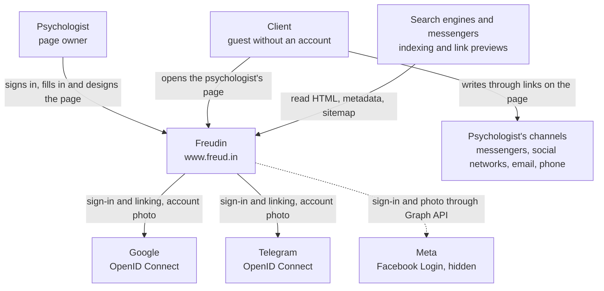

# System context — Freudin

Level **L1 — System Context** of the C4 model. It shows Freudin as a whole: who uses it and
which external systems it connects to. What the system is made of — [containers](2.containers.md),
internals — [components](3.components.md) and [code details](4.code.md). Interaction
scenarios — [dynamic views](dynamic.md). About the product — [`docs/PRODUCT.md`](../PRODUCT.md).

## System

**Freudin** (`www.freud.in`) is a website where a psychologist builds a profile page
`/<username>`, and a client finds the psychologist without signing up and contacts them
directly. The site is a minimal intermediary: it does not vet psychologists, take part in
communication or take payment.

## Users

| Who | What they do in the system | Sign-in |
|---|---|---|
| **Psychologist** | Creates the page in onboarding, edits it in `/settings` (practice data, FAQ, services, documents, appearance), hides the page or sets a password, shares the link and QR code, deletes the account | Google or Telegram; several methods can be linked to one account |
| **Client** | Opens `/<username>`, reads the page, follows the psychologist's contacts. Opens a hidden page with a password | None |
| **Search engines and messengers** | Index profile and legal pages, build link previews from Open Graph | None |

## External systems

| System | Connection | Why |
|---|---|---|
| **Google** | Freudin ↔ Google OIDC | Sign-in and linking without Supabase OAuth: the Google screen shows our site. The account photo is used for the avatar |
| **Telegram** | Freudin ↔ `oauth.telegram.org` | Same as Google. On localhost sign-in goes through Supabase OAuth: Telegram does not accept `http://` |
| **Meta (Facebook)** | Freudin ↔ Facebook Login, Graph API | Sign-in is ready but hidden until the company is verified in Meta. The 512×512 photo comes from the Graph API |
| **Psychologist's channels** | Client → channel | Freudin does not relay messages: the page only has links (`mailto:`, `tel:`, WhatsApp, Telegram, websites, social networks) |

The services the system itself runs on (Vercel, Supabase) are described at the
[container](2.containers.md) level: they hold our data and code.

## What the system does not have

- Payments, session booking, messaging and diploma checks: this is the product boundary, see
  `docs/PRODUCT.md`.
- Analytics and third-party scripts in the browser: only our own cookies (session, sign-in
  attempt, hidden page access); browser storage holds the theme, the onboarding draft and the
  editor state. Adding analytics or a third-party service means updating `/privacy` and `/terms`.
- In the plan (`docs/PLAN.md`): a psychologist catalog, a feed of social media posts (stage K),
  AI matching and writing help (stage L). When they appear, they become new links on this diagram.
