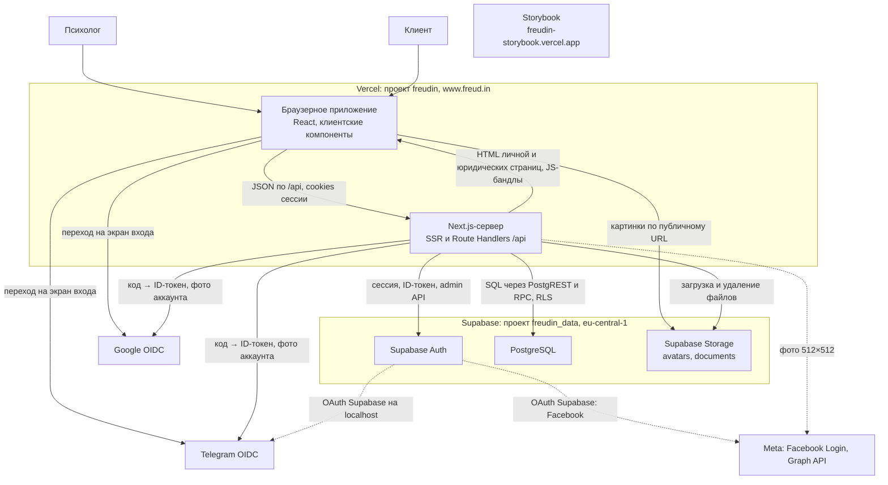
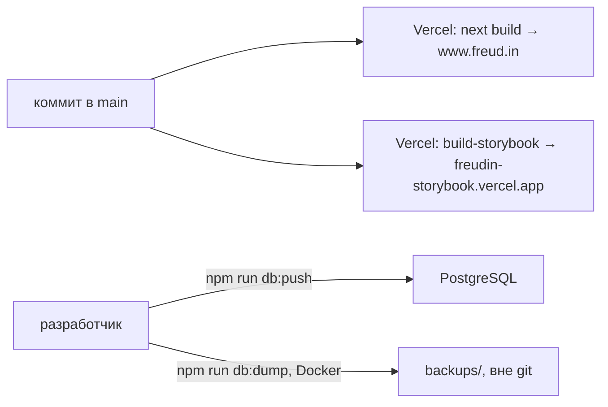

# Контейнеры — Freudin

Уровень **L2 — Container** C4-модели. Показывает, из каких запускаемых частей состоит Freudin,
как они связаны между собой и с [внешними системами](1.context.md), как собираются
и разворачиваются. Внутреннее устройство — в [компонентах](3.components.md)
и [деталях кода](4.code.md), взаимодействия во времени — в [dynamic.md](dynamic.md).

## Схема

## Контейнеры

| Контейнер | Технологии | Ответственность |
|---|---|---|
| **Браузерное приложение** | React 19 (React Compiler), Next.js App Router на клиенте, TanStack Query и Form, Zustand, zod, Tailwind CSS 4, shadcn/ui (Radix) | Весь интерфейс, кроме серверного HTML: вход, онбординг, редактор `/settings` с превью, интерактив личной страницы. Данные берёт только из `/api` через `apiClient`; к Supabase напрямую не ходит. Кроп и сжатие картинок делает до загрузки |
| **Next.js-сервер** | Next.js 16 на Vercel Functions (Node.js), `@supabase/ssr`, `@supabase/supabase-js`, zod | Серверный рендер `/<username>` (с `generateMetadata`), `/privacy`, `/terms`; статические страницы и metadata-файлы; Route Handlers `src/app/api` — HTTP: сессия, валидация и ответы; серверные функции сущностей — работа с данными. Единственный, кто знает ключи Supabase и секреты провайдеров |
| **Supabase Auth** | GoTrue в облаке Supabase | Пользователи и их способы входа (identities), JWT-сессии. Сессию создаёт по ID-токену Google или Telegram (`signInWithIdToken`) или через свой OAuth (Facebook, Telegram на localhost). Включён Allow manual linking |
| **PostgreSQL** | Postgres Supabase, PostgREST, RLS | Профили, приватные данные, справочник городов, доступ к скрытым страницам; функции `security definer` для скрытых страниц и CHECK-функции jsonb. Схема — миграции `supabase/migrations` |
| **Supabase Storage** | Публичные bucket'ы | `avatars` и `documents`: файлы в папке `<user_id>/`, JPEG, PNG, WebP до 2 МБ. Пишет только Next.js-сервер, читает браузер по публичной ссылке (кеш год, имена файлов уникальные) |
| **Storybook** | Storybook 10, `@storybook/nextjs-vite` | UI kit: компоненты, виджеты и токены темы на фикстурах. Отдельный проект Vercel, закрыт Vercel Authentication. С продом не связан |

## Связи и протоколы

| Откуда → куда | Как | Что важно |
|---|---|---|
| Браузер → Next.js `/api` | HTTPS, JSON или `multipart/form-data` | Только same-origin: изменяющий запрос с чужого сайта — 403. Ошибка — `{ error: { code, message, fields? } }` |
| Next.js → Supabase | HTTPS, `@supabase/*` | Три клиента: от имени пользователя (publishable key + cookies, RLS), гостевой `anon` (без cookies), admin (secret key, мимо RLS — только удаление аккаунта) |
| Браузер ↔ Next.js: сессия | httpOnly cookies `sb-*` | Браузер их не читает; обновлённую сессию пишет `requireUser()` |
| Next.js → Google, Telegram | HTTPS, OIDC с PKCE | Обмен кода на ID-токен (таймаут 10 с). Состояние попытки — cookie `freudin-<provider>-sign-in` на 10 минут |
| Next.js → фото провайдера | HTTPS | Копия фото аккаунта в `avatars` по запросу пользователя |
| Браузер → Storage | HTTPS, публичный URL | Фото и документы. У скрытой страницы старые прямые ссылки остаются рабочими |

## Конфигурация

Все переменные серверные (без `NEXT_PUBLIC_`), читаются через `getServerEnv()`; шаблон —
`.env.example`, подробности — раздел «Переменные окружения» в [`README.md`](../../README.md).

| Переменные | Кто использует |
|---|---|
| `SUPABASE_URL`, `SUPABASE_PUBLISHABLE_KEY`, `SUPABASE_SECRET_KEY` | Next.js-сервер |
| `GOOGLE_CLIENT_ID`, `GOOGLE_CLIENT_SECRET`, `TELEGRAM_CLIENT_ID`, `TELEGRAM_CLIENT_SECRET` | Next.js-сервер (вход без OAuth Supabase); те же значения заданы в провайдерах Supabase Auth |
| `SUPABASE_ACCESS_TOKEN`, `SUPABASE_DB_PASSWORD` | Только Supabase CLI: миграции и типы |

## Хранилище браузера

Всё перечислено в `/privacy`, раздел 2. Новый ключ — только вместе с правкой `/privacy`
и `/terms` (правило 11 `docs/workflows/process.md`).

| Ключ | Где | Что |
|---|---|---|
| `sb-*` | cookie, httpOnly | сессия Supabase |
| `sb-…-code-verifier` | cookie, httpOnly | PKCE при входе через OAuth Supabase (Facebook, Telegram на localhost) |
| `freudin-<provider>-sign-in` | cookie, httpOnly, 10 минут | попытка входа или привязки через Google и Telegram |
| `freudin-page-access-<username>` | cookie, httpOnly, 30 дней | доступ гостя к странице с паролем |
| `theme` | localStorage | тема next-themes |
| `freudin:onboarding-draft` | sessionStorage | черновик онбординга (Zustand `persist`) |
| `freudin:settings-collapsed-blocks` | localStorage | свёрнутые блоки настроек |
| `freudin:page-checklist` | localStorage | скрытые подсказки владельца «Finish your page» |

## Кеширование

| Что | Где кешируется |
|---|---|
| Статика Next.js, иконки, `opengraph-image.jpg` | CDN Vercel |
| `GET /api/cities` | CDN Vercel: `s-maxage` сутки, браузер — час |
| Ответы с данными пользователя | Не кешируются: `Cache-Control: private, no-store` |
| Картинки Storage | CDN Supabase и браузер, год |
| Данные `/api` в браузере | TanStack Query: `staleTime` 60 с, 4xx не ретраятся |

## Сборка и развёртывание

- Каждый коммит в `main` сразу уходит в прод; превью-деплоев и отдельного стенда нет.
  `freud.in` редиректит на `www.freud.in`.
- Один проект Supabase и для разработки, и для прода: локальный `npm run dev` работает
  с боевой базой.
- Миграции применяет разработчик вручную (`npm run db:push`), затем генерирует типы
  (`npm run db:types`). Тариф Free: автоматических бэкапов нет, проект засыпает без обращений
  неделю.
- CI пока нет: `lint`, `typecheck`, `test` и `build` запускаются локально (шаг 18.7 плана).

## Технологический стек

Полная таблица — раздел [«Стек» в README](../../README.md#стек), версии — `package.json`.
