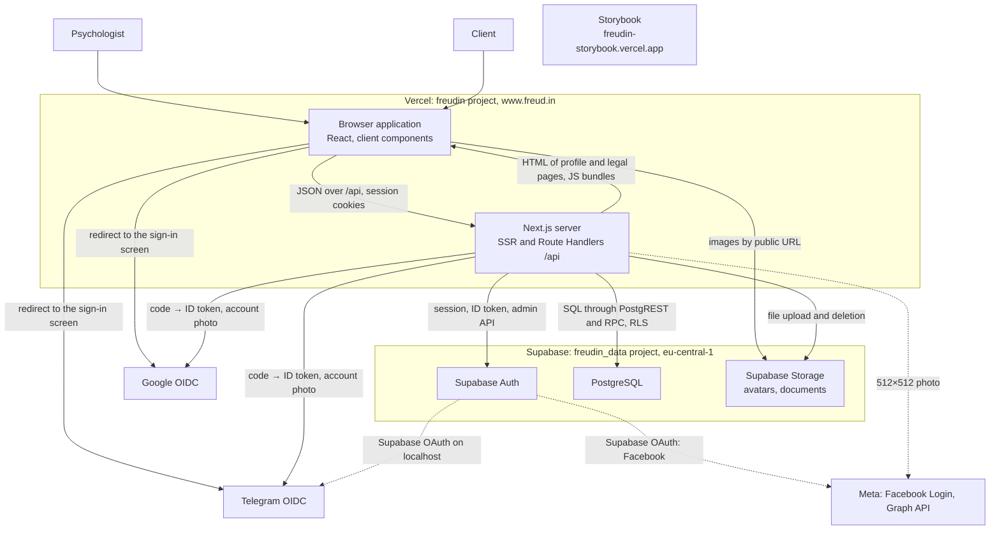
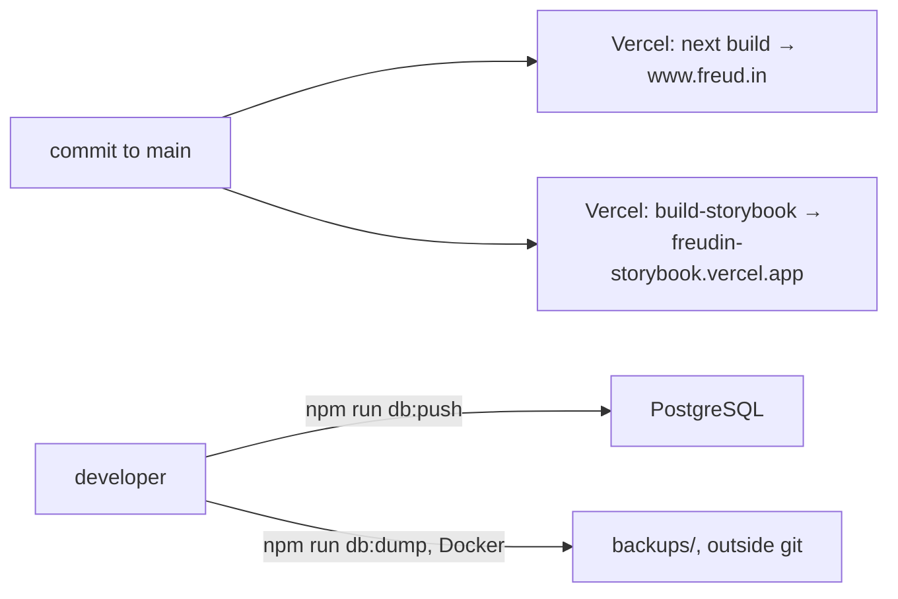

# Containers — Freudin

Level **L2 — Container** of the C4 model. It shows which runnable parts Freudin consists of, how
they connect to each other and to the [external systems](1.context.md), and how they are built
and deployed. Internals — [components](3.components.md) and [code details](4.code.md),
interactions over time — [dynamic.md](dynamic.md).

## Diagram

## Containers

| Container | Technologies | Responsibility |
|---|---|---|
| **Browser application** | React 19 (React Compiler), Next.js App Router on the client, TanStack Query and Form, Zustand, zod, Tailwind CSS 4, shadcn/ui (Radix) | The whole UI except server HTML: sign-in, onboarding, the `/settings` editor with preview, profile page interactivity. Gets data only from `/api` through `apiClient`; never calls Supabase directly. Crops and compresses images before upload |
| **Next.js server** | Next.js 16 on Vercel Functions (Node.js), `@supabase/ssr`, `@supabase/supabase-js`, zod | Server rendering of `/<username>` (with `generateMetadata`), `/privacy`, `/terms`; static pages and metadata files; Route Handlers `src/app/api` — HTTP: session, validation and responses; entity server functions — data work. The only part that knows Supabase keys and provider secrets |
| **Supabase Auth** | GoTrue in the Supabase cloud | Users and their sign-in methods (identities), JWT sessions. Creates a session from a Google or Telegram ID token (`signInWithIdToken`) or through its own OAuth (Facebook, Telegram on localhost). Allow manual linking is on |
| **PostgreSQL** | Supabase Postgres, PostgREST, RLS | Profiles, private data, the city directory, hidden page access; `security definer` functions for hidden pages and jsonb CHECK functions. Schema — migrations in `supabase/migrations` |
| **Supabase Storage** | Public buckets | `avatars` and `documents`: files in a `<user_id>/` folder, JPEG, PNG, WebP up to 2 MB. Only the Next.js server writes; the browser reads by public URL (cached for a year, file names are unique) |
| **Storybook** | Storybook 10, `@storybook/nextjs-vite` | UI kit: components, widgets and theme tokens on fixtures. A separate Vercel project, protected by Vercel Authentication. Not connected to production |

## Links and protocols

| From → to | How | What matters |
|---|---|---|
| Browser → Next.js `/api` | HTTPS, JSON or `multipart/form-data` | Same-origin only: a mutating request from another site gets 403. An error is `{ error: { code, message, fields? } }` |
| Next.js → Supabase | HTTPS, `@supabase/*` | Three clients: on behalf of the user (publishable key + cookies, RLS), guest `anon` (no cookies), admin (secret key, bypasses RLS — account deletion only) |
| Browser ↔ Next.js: session | httpOnly cookies `sb-*` | The browser cannot read them; `requireUser()` writes a refreshed session |
| Next.js → Google, Telegram | HTTPS, OIDC with PKCE | Exchanging the code for an ID token (10 s timeout). The attempt state is the `freudin-<provider>-sign-in` cookie for 10 minutes |
| Next.js → provider photo | HTTPS | A copy of the account photo in `avatars` at the user's request |
| Browser → Storage | HTTPS, public URL | Photos and documents. For a hidden page, old direct links keep working |

## Configuration

All variables are server-side (no `NEXT_PUBLIC_`) and read through `getServerEnv()`; the
template is `.env.example`, details — the «Переменные окружения» section of
[`README.md`](../../README.md).

| Variables | Used by |
|---|---|
| `SUPABASE_URL`, `SUPABASE_PUBLISHABLE_KEY`, `SUPABASE_SECRET_KEY` | Next.js server |
| `GOOGLE_CLIENT_ID`, `GOOGLE_CLIENT_SECRET`, `TELEGRAM_CLIENT_ID`, `TELEGRAM_CLIENT_SECRET` | Next.js server (sign-in without Supabase OAuth); the same values are set in the Supabase Auth providers |
| `SUPABASE_ACCESS_TOKEN`, `SUPABASE_DB_PASSWORD` | Supabase CLI only: migrations and types |

## Browser storage

Everything is listed in `/privacy`, section 2. A new key comes only together with an update of
`/privacy` and `/terms` (rule 11 of `docs/workflows/process.md`).

| Key | Where | What |
|---|---|---|
| `sb-*` | cookie, httpOnly | Supabase session |
| `sb-…-code-verifier` | cookie, httpOnly | PKCE for sign-in through Supabase OAuth (Facebook, Telegram on localhost) |
| `freudin-<provider>-sign-in` | cookie, httpOnly, 10 minutes | a sign-in or linking attempt through Google and Telegram |
| `freudin-page-access-<username>` | cookie, httpOnly, 30 days | a guest's access to a password-protected page |
| `theme` | localStorage | next-themes theme |
| `freudin:onboarding-draft` | sessionStorage | onboarding draft (Zustand `persist`) |
| `freudin:settings-collapsed-blocks` | localStorage | collapsed settings blocks |
| `freudin:page-checklist` | localStorage | the owner's hidden «Finish your page» tips |

## Caching

| What | Where it is cached |
|---|---|
| Next.js static assets, icons, `opengraph-image.jpg` | Vercel CDN |
| `GET /api/cities` | Vercel CDN: `s-maxage` one day, browser one hour |
| Responses with user data | Not cached: `Cache-Control: private, no-store` |
| Storage images | Supabase CDN and the browser, one year |
| `/api` data in the browser | TanStack Query: `staleTime` 60 s, 4xx not retried |

## Build and deployment

- Every commit to `main` goes straight to production; there are no preview deploys and no
  separate staging. `freud.in` redirects to `www.freud.in`.
- One Supabase project serves both development and production: the local `npm run dev` works
  with the production database.
- The developer applies migrations by hand (`npm run db:push`), then generates types
  (`npm run db:types`). Free plan: no automatic backups, and the project pauses after a week
  without requests.
- CI — GitHub Actions on every push to `main` and pull request: `lint`, `typecheck`, `test`,
  `build` and `build-storybook`. Vercel deploys without waiting for it; only `main` branch
  protection in GitHub can block a merge.

## Technology stack

The full table — the [«Стек» section of the README](../../README.md#стек), versions — `package.json`.
