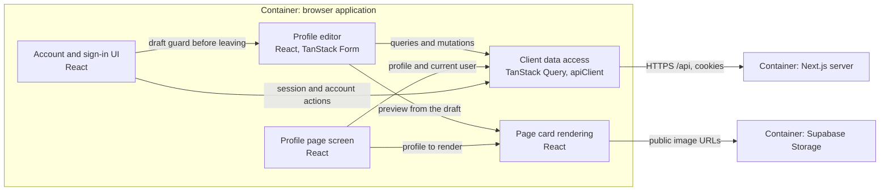
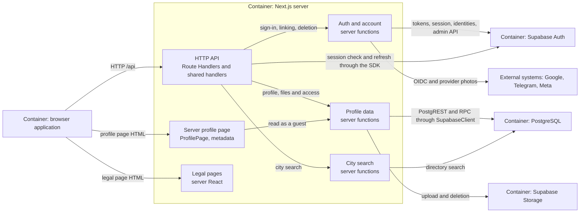

# Components — Freudin

Level **L3 — Component** of the C4 model: the functional components inside each
[container](2.containers.md), their responsibilities, interfaces and static dependencies.
Each diagram is bounded by one container; related containers are shown outside it.
Level definition — [Component diagram in C4](https://c4model.com/diagrams/component).

A component here is a group of related functionality behind an interface, not any folder,
React component or FSD layer. One slice can contain parts of several containers: for example,
the `profile` client queries and the server-side profile work belong to different components.
This describes the existing system; it introduces no new layers or APIs.

To find files, use the [code map](../code-map.md). Sequences of operations —
[dynamic views](dynamic.md), the inner structure of selected components — [L4](4.code.md).

## Browser application

Boundary: code executed in the browser. Server rendering of the profile and legal pages is not
part of this diagram. Shared visual primitives and providers appear through component
responsibilities; there is no full list of React components here.

| Component | Responsibility | Interface and link to the implementation |
|---|---|---|
| Profile editor | Onboarding and settings: form, draft, Save, preview and documents | Client views and the form; [editor modules](../code-map.md#widgets-profile-form) |
| Profile page screen | Client page state, owner detection, opening a page with a password | SSR data and client queries; [views/profile](../code-map.md#views-profile) |
| Page card rendering | Shared visual assembly of the page and the preview | Profile props and appearance; [profile-card](../code-map.md#widgets-profile-card) |
| Account and sign-in UI | Choosing a provider, linking, sign-out and account deletion | User actions; [account-settings](../code-map.md#widgets-account-settings) and [sign-in-panel](../code-map.md#widgets-sign-in-panel) |
| Client data access | Queries, mutations, cache, HTTP and errors | Entity query options and hooks, apiClient; [viewer](../code-map.md#entities-viewer), [shared/api](../code-map.md#shared-api) |

Server data lives only in TanStack Query; Zustand is for UI and drafts. Checking the session
through ViewerGuard gives a skeleton and a redirect, while the server checks data access.
Documents and account actions are saved independently of the form's Save. Before sign-out or
linking a provider leaves the editor, the account UI asks the form's guard to save, discard or
keep its draft. The preview does not expose private fields. State and saving details — in the
[scenarios](dynamic.md#saving-the-profile).

## Next.js server

Boundary: Next.js server code. The API and SSR use entity server functions; the server
components of the legal pages contain static texts.

| Component | Responsibility | Interface and boundaries |
|---|---|---|
| HTTP API | Session, CSRF, validation, status codes, redirects | HTTP /api; data functions do not live in the handler; [API rules](../workflows/api.md) |
| Server profile page | The profile as a guest sees it, metadata, 404 and the canonical address | ProfilePage and generateMetadata; [implementation](../../src/views/profile/index.server.ts) |
| Legal pages | Server HTML of Privacy and Terms | Server views and legal-document, no client JS |
| Auth and account | OIDC/OAuth, sign-in methods, sign-out, user deletion | [viewer/index.server.ts](../../src/entities/viewer/index.server.ts); secrets stay on the server |
| Profile data | Reading and writing the profile, username, private data, photo, documents and access | [profile/index.server.ts](../../src/entities/profile/index.server.ts); the caller passes the SupabaseClient |
| City search | Directory search | [location/index.server.ts](../../src/entities/location/index.server.ts); no direct browser access to the DB |

Arrows from data functions to PostgreSQL and Storage mean SDK calls through the passed
SupabaseClient, not a new client created in every function. An entity function returns an
expected outcome as a result; the API layer forms HTTP errors. Client factories and the server
env are shared implementation details, not separate business components of this diagram; find
them through the [shared/api card](../code-map.md#shared-api). The user, guest and service
clients differ in RLS rights and cookie handling.

## PostgreSQL and Storage

In the PostgreSQL container, the logical group **«Profile and directory storage»** combines
public and private data, the city directory and the SQL access rules. Its interfaces are the
allowed PostgREST queries and RPCs; RLS, grants and security definer functions set the
boundaries. A table alone is not a separate C4 component.

Storage offers upload and deletion to the server and public image URLs to the browser. Hiding
a page does not revoke file URLs obtained earlier. Specific tables, SQL functions, columns and
buckets — in the [storage details](4.code.md#postgresql-and-storage).

## Keeping this description current

- Update a component when its responsibility, interface or dependency changes.
- Files and exports are tracked in the [code map](../code-map.md) and the source public APIs.
- Change sequences of operations in the [dynamic views](dynamic.md).
- Add code details to [L4](4.code.md) only for a selected complex component.
- FSD and import rules — [code.md](../workflows/code.md), server rules — [api.md](../workflows/api.md).
