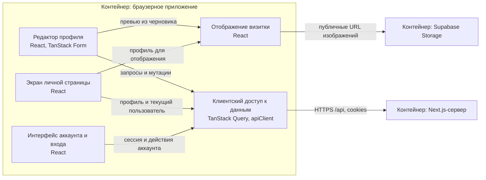
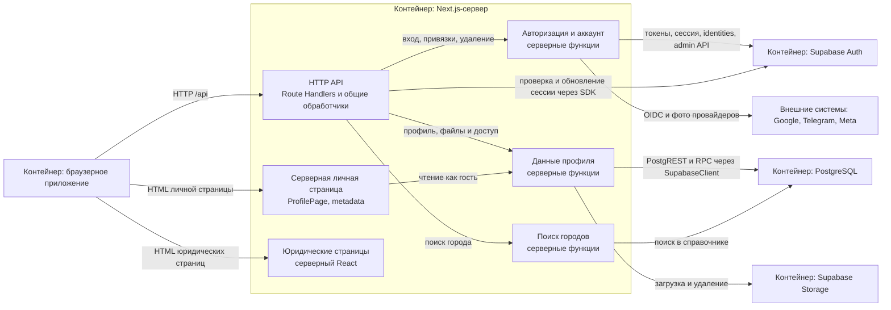

# Компоненты — Freudin

Уровень **L3 — Component** C4-модели: функциональные компоненты внутри каждого
[контейнера](2.containers.md), их ответственность, интерфейсы и статические зависимости.
Каждая схема ограничена одним контейнером; связанные контейнеры показаны снаружи.
Определение уровня — [Component diagram в C4](https://c4model.com/diagrams/component).

Компонент здесь — группа связанной функциональности за интерфейсом, а не любая папка,
React-компонент или FSD-слой. Один слайс может содержать части нескольких контейнеров:
например, клиентские запросы `profile` и серверная работа с профилем относятся к разным компонентам.
Это описание существующей системы, новых слоёв или API оно не вводит.

Для поиска файлов используй [карту кода](../code-map.md). Последовательности операций —
[динамические представления](dynamic.md), внутренняя структура выбранных компонентов — [L4](4.code.md).

## Браузерное приложение

Граница: код, исполняемый в браузере. Серверный рендер личной и юридических страниц
в эту схему не входит. Общие визуальные примитивы и провайдеры показаны через обязанности
компонентов; полного перечня React-компонентов здесь нет.

| Компонент | Ответственность | Интерфейс и связь с реализацией |
|---|---|---|
| Редактор профиля | Онбординг и настройки: форма, черновик, Save, превью и документы | Клиентские view и форма; [модули редактора](../code-map.md#widgets-profile-form) |
| Экран личной страницы | Клиентское состояние страницы, определение владельца, открытие страницы по паролю | Данные SSR и клиентские запросы; [views/profile](../code-map.md#views-profile) |
| Отображение визитки | Общая визуальная сборка страницы и превью | Props профиля и оформление; [profile-card](../code-map.md#widgets-profile-card) |
| Интерфейс аккаунта и входа | Выбор провайдера, привязки, выход и удаление аккаунта | Действия пользователя; [account-settings](../code-map.md#widgets-account-settings) и [sign-in-panel](../code-map.md#widgets-sign-in-panel) |
| Клиентский доступ к данным | Запросы, мутации, кеш, HTTP и ошибки | Query options и хуки сущностей, apiClient; [viewer](../code-map.md#entities-viewer), [shared/api](../code-map.md#shared-api) |

Серверные данные живут только в TanStack Query; Zustand — для UI и черновиков. Проверка
сессии через ViewerGuard даёт скелетон и перенаправление, а доступ к данным проверяет сервер.
Документы и действия аккаунта сохраняются независимо от Save формы. Превью не раскрывает
приватные поля. Детали состояния и сохранения — в [сценариях](dynamic.md#сохранение-профиля).

## Next.js-сервер

Граница: серверный код Next.js. API и SSR используют серверные функции сущностей;
серверные компоненты юридических страниц содержат статические тексты.

| Компонент | Ответственность | Интерфейс и границы |
|---|---|---|
| HTTP API | Сессия, CSRF, валидация, коды ответов, редиректы | HTTP /api; функции данных не живут в обработчике; [правила API](../workflows/api.md) |
| Серверная личная страница | Профиль глазами гостя, metadata, 404 и канонический адрес | ProfilePage и generateMetadata; [реализация](../../src/views/profile/index.server.ts) |
| Юридические страницы | Серверный HTML Privacy и Terms | Серверные view и legal-document, без клиентского JS |
| Авторизация и аккаунт | OIDC/OAuth, способы входа, выход, удаление пользователя | [viewer/index.server.ts](../../src/entities/viewer/index.server.ts); секреты остаются на сервере |
| Данные профиля | Чтение и запись профиля, username, приватные данные, фото, документы и доступ | [profile/index.server.ts](../../src/entities/profile/index.server.ts); SupabaseClient передаётся вызывающим кодом |
| Поиск городов | Поиск по справочнику | [location/index.server.ts](../../src/entities/location/index.server.ts); без прямого браузерного доступа к БД |

Стрелки от функций данных к PostgreSQL и Storage означают вызовы SDK через переданный
SupabaseClient. Они не означают создание нового клиента в каждой функции. Ожидаемый исход
функции сущности возвращается как результат; HTTP-ошибки формирует слой API.
Фабрики клиентов и серверный env — общие детали реализации, а не отдельные бизнес-компоненты
этой схемы; они находятся по [карточке shared/api](../code-map.md#shared-api).
Пользовательский, гостевой и служебный клиенты отличаются правами RLS и работой с cookies.

## PostgreSQL и Storage

В контейнере PostgreSQL логическая группа **«Хранение профилей и справочников»** объединяет
публичные и приватные данные, справочник городов и SQL-правила доступа. Её интерфейсы —
разрешённые запросы PostgREST и RPC; RLS, grants и security-definer-функции задают границы.
Таблица сама по себе не считается отдельным компонентом C4.

Storage предоставляет загрузку и удаление серверу и публичные URL изображений браузеру.
Скрытие страницы не отзывает ранее полученные URL файлов. Конкретные таблицы, SQL-функции,
колонки и bucket'ы — в [детализации хранения](4.code.md#postgresql-и-storage).

## Как поддерживать описание

- Обновляй компонент при изменении ответственности, интерфейса или зависимости.
- Состав файлов и экспортов ведётся в [карте кода](../code-map.md) и public API исходников.
- Последовательности операций меняй в [динамических представлениях](dynamic.md).
- Подробности кода добавляй в [L4](4.code.md) только для выбранного сложного компонента.
- Правила FSD и импорта — [code.md](../workflows/code.md), сервера — [api.md](../workflows/api.md).

## Прежние ссылки на каталог

Разделы навигации перенесены в [карту кода](../code-map.md); старые якоря ведут к ссылкам
на соответствующие разделы, без копирования их содержимого.

- [Где искать изменение](../code-map.md#где-искать-изменение).

- [Слои кода](../code-map.md#слои-кода).

- [Серверные функции по сущностям](../code-map.md#сущности).

- [Экраны и виджеты](../code-map.md#экраны).

- [Каталог слайсов](../code-map.md#каталог-слайсов).

- [entities/viewer](../code-map.md#entities-viewer).

- [entities/profile](../code-map.md#entities-profile).

- [entities/location](../code-map.md#entities-location).

- [entities/social-link](../code-map.md#entities-social-link).

- [Виджеты](../code-map.md#виджеты).

- [widgets/profile-form](../code-map.md#widgets-profile-form).

- [widgets/profile-card](../code-map.md#widgets-profile-card).

- [widgets/profile-documents](../code-map.md#widgets-profile-documents).

- [widgets/account-settings](../code-map.md#widgets-account-settings).

- [widgets/sign-in-panel](../code-map.md#widgets-sign-in-panel).

- [widgets/header и widgets/footer](../code-map.md#widgets-header-footer).

- [widgets/legal-document](../code-map.md#widgets-legal-document).

- [Общие модули](../code-map.md#общие-модули).

- [shared/api](../code-map.md#shared-api).

- [shared/config](../code-map.md#shared-config).

- [shared/ui](../code-map.md#shared-ui).

- [shared/lib](../code-map.md#shared-lib).

- [views-settings](../code-map.md#views-settings).

- [views-onboarding](../code-map.md#views-onboarding).

- [views-profile](../code-map.md#views-profile).
