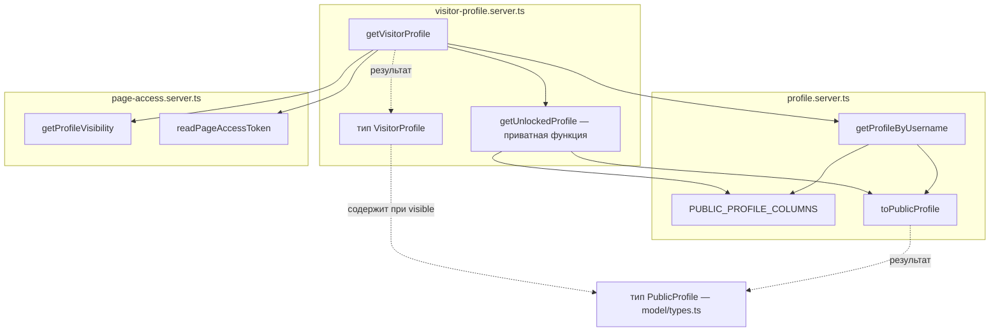

# Внутреннее устройство компонентов — Freudin

Уровень **L4 — Code** C4-модели: выборочные статические детали реализации компонентов из
[L3](3.components.md). Это не полный каталог файлов и не описание сквозных запросов.
Для поиска модулей — [карта кода](../code-map.md), для взаимодействий во времени — [dynamic.md](dynamic.md).
Назначение и необязательность уровня — [Code diagram в C4](https://c4model.com/diagrams/code).

Здесь две отдельные детализации: серверный компонент «Данные профиля» и компонент
«Хранение профилей и справочников» в PostgreSQL. Диаграмма каждого уровня Code раскрывает
один компонент; подробности остальных доступны из исходников и IDE по необходимости.

## Данные профиля: чтение страницы гостем

Область: функции чтения внутри серверного компонента «Данные профиля». Схема показывает
зависимости функций и используемые определения; стрелки не задают хронологию запросов.
Внешние HTTP, SSR и переходы браузера описаны отдельно в [сценарии страницы](dynamic.md#личная-страница-username).

| Элемент | Файл | Контракт / существенная деталь |
|---|---|---|
| getVisitorProfile, VisitorProfile | [visitor-profile.server.ts](../../src/entities/profile/api/visitor-profile.server.ts) | Принимает SupabaseClient и username; возвращает visible, hidden или null |
| getUnlockedProfile | Тот же модуль | Приватный helper; проверяет UUID токена, читает защищённый профиль через RPC |
| getProfileByUsername | [profile.server.ts](../../src/entities/profile/api/profile.server.ts) | Нормализует username, поддерживает demo, использует PUBLIC_PROFILE_COLUMNS |
| toPublicProfile, PUBLIC_PROFILE_COLUMNS | Тот же модуль | Преобразование строки БД и разрешённый гостевой набор полей |
| getProfileVisibility, readPageAccessToken | [page-access.server.ts](../../src/entities/profile/api/page-access.server.ts) | Режим из RPC; токен из httpOnly-cookie запроса, без сессии владельца |
| PublicProfile | [types.ts](../../src/entities/profile/model/types.ts) | Публичные данные страницы; приватные сведения пользователя описаны отдельно |

Public API компонента — [index.server.ts](../../src/entities/profile/index.server.ts).
`getUnlockedProfile`, `PUBLIC_PROFILE_COLUMNS` и `toPublicProfile` не экспортируются через него;
ссылки на внутренние файлы служат для чтения, не разрешают обход public API.

Другие части компонента — запись профиля, файлы и приватные данные — находятся по
[карточке profile](../code-map.md#entities-profile). Порядок записи и известная неатомарность
описаны в [динамическом представлении](dynamic.md#сохранение-профиля), а не на этой статической схеме.

## Хранение профилей и справочников

Область: внутренняя модель данных компонента PostgreSQL из L3 и используемые им файлы Storage.
Ниже перечислены объекты реализации, а не отдельные компоненты C4. Схема —
[миграции](../../supabase/migrations), её генерируемое TypeScript-представление —
[database.types.ts](../../src/shared/api/supabase/database.types.ts).
Правила изменения схемы — [database.md](../workflows/database.md).

### PostgreSQL и Storage

| Объект | Тип | Кто читает и пишет |
|---|---|---|
| `profiles` | Таблица: публичная страница (username, имя, описание, данные практики, ссылки, контакты, FAQ, услуги, документы и оформление в jsonb, `visibility`) | Владелец — всё своё; `anon` — только колонки `PUBLIC_PROFILE_COLUMNS` открытых страниц |
| `profile_private` | Таблица: дата рождения, пол, запросы клиентов (для будущего поиска) | Только владелец |
| `account_contacts` | Таблица: контактная почта, если провайдер её не дал | Только владелец |
| `profile_page_access` | Таблица: пароль и токен доступа скрытой страницы | Пароль читает владелец; гость — только через функции |
| `cities` | Справочник GeoNames, около 64 тыс. городов | Все на чтение; заполняется миграциями |
| `get_profile_visibility`, `unlock_profile_page`, `get_unlocked_profile`, `set_profile_visibility` | Функции `security definer` | Режим страницы по адресу (и занят ли адрес), проверка пароля, страница по токену, запись режима и пароля |
| `is_valid_profile_faq`, `is_valid_profile_services` | CHECK-функции | Проверка jsonb-списков, повторяют zod-схемы: длины строк, категория карточки услуги — из `client_types` |
| `avatars`, `documents` | Публичные bucket'ы Storage | Пишет владелец в папку `<user_id>/`, читают все по URL |

Особенности колонок `profiles`:

- **Цены.** Валюта одна на профиль: колонка `price_currency` (имя осталось от прежней схемы,
  NULL читается как USD). Цена сессии `price_amount` и цены карточек услуг хранятся без валюты;
  у старых карточек валюта осталась в jsonb и не читается (миграция `*_use_profile_currency.sql`).
- **Содержимое страницы:** `faq`, `services`, `highlighted_sections`, `cover` (миграция
  `*_add_page_content.sql`). Выделение отдельной ссылки или карточки — поле `highlighted`
  в самом элементе jsonb, у ссылки ещё необязательный заголовок `title`.
- **Оформление:** `page_theme` (пресет фона и карточки, `data-page-theme` на `ProfileCanvas`,
  цвета — токены раздела «Оформление личной страницы» в `globals.css`), `link_icons` (логотипы
  платформ на кнопках), `cta_placement` (`sticky` — главная кнопка закреплена внизу экрана, когда
  страница уже 32rem). Миграция `*_add_page_appearance.sql`.

Пользователи и способы входа хранятся в схеме `auth` (Supabase Auth). `profiles`,
`profile_private` и `account_contacts` ссылаются на `auth.users` с каскадным удалением.

## Прежние ссылки на потоки

Сквозные сценарии перенесены в динамические представления; прежние якоря сохранены:

- [Запрос из браузера к API](dynamic.md#запрос-из-браузера-к-api).

- [Вход через Google и Telegram](dynamic.md#вход-через-google-и-telegram).

- [Особенности провайдеров](dynamic.md#особенности-провайдеров).

- [Привязка способа входа](dynamic.md#привязка-способа-входа).

- [Личная страница `/<username>`](dynamic.md#личная-страница-username).

- [Скрытая страница](dynamic.md#скрытая-страница).

- [Фото и документы](dynamic.md#фото-и-документы).

- [Сохранение профиля](dynamic.md#сохранение-профиля).

- [Удаление аккаунта](dynamic.md#удаление-аккаунта).

- [Состояние в браузере](dynamic.md#состояние-в-браузере).

- [Прежнее описание сквозных механизмов](dynamic.md).
