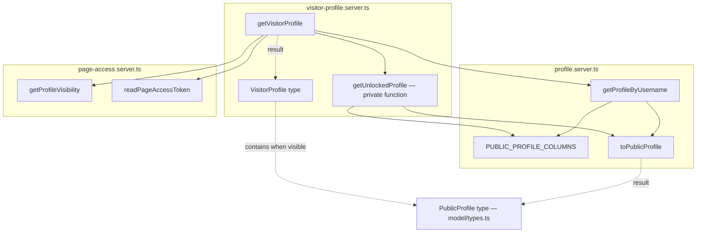

# Component internals — Freudin

Level **L4 — Code** of the C4 model: selected static implementation details of components from
[L3](3.components.md). It is not a full file catalog and does not describe end-to-end requests.
To find modules — the [code map](../code-map.md), interactions over time — [dynamic.md](dynamic.md).
The purpose of this optional level — [Code diagram in C4](https://c4model.com/diagrams/code).

There are two separate breakdowns: the server component «Profile data» and the component
«Profile and directory storage» in PostgreSQL. Each Code diagram opens up one component; the
others can be explored in the sources and the IDE when needed.

## Profile data: a guest reading a page

Scope: the read functions inside the «Profile data» server component. The diagram shows
function dependencies and the definitions they use; arrows do not set the order of requests.
External HTTP, SSR and browser navigation are described separately in the
[page scenario](dynamic.md#profile-page-username).

| Element | File | Contract / key detail |
|---|---|---|
| getVisitorProfile, VisitorProfile | [visitor-profile.server.ts](../../src/entities/profile/api/visitor-profile.server.ts) | Takes a SupabaseClient and a username; returns visible, hidden or null |
| getUnlockedProfile | Same module | Private helper; validates the token UUID, reads the protected profile through RPC |
| getProfileByUsername | [profile.server.ts](../../src/entities/profile/api/profile.server.ts) | Normalises the username, supports demo, uses PUBLIC_PROFILE_COLUMNS |
| toPublicProfile, PUBLIC_PROFILE_COLUMNS | Same module | Converting a DB row and the allowed guest field set |
| getProfileVisibility, readPageAccessToken | [page-access.server.ts](../../src/entities/profile/api/page-access.server.ts) | Mode from RPC; token from the request's httpOnly cookie, without the owner's session |
| PublicProfile | [types.ts](../../src/entities/profile/model/types.ts) | Public page data; the user's private data is described separately |

The component's public API is [index.server.ts](../../src/entities/profile/index.server.ts).
`getUnlockedProfile`, `PUBLIC_PROFILE_COLUMNS` and `toPublicProfile` are not exported through
it; links to internal files are for reading and do not permit bypassing the public API.

Other parts of the component — profile writes, files and private data — are found through the
[profile card](../code-map.md#entities-profile). The transactional write and the version check
are described in the [dynamic view](dynamic.md#saving-the-profile), not on this static diagram.

## Profile and directory storage

Scope: the internal data model of the PostgreSQL component from L3 and the Storage files it
uses. Below are implementation objects, not separate C4 components. Schema —
[migrations](../../supabase/migrations), its generated TypeScript representation —
[database.types.ts](../../src/shared/api/supabase/database.types.ts).
Schema change rules — [database.md](../workflows/database.md).

### PostgreSQL and Storage

| Object | Type | Who reads and writes |
|---|---|---|
| `profiles` | Table: the public page (username, name, description, practice data, links, contacts, FAQ, services, documents and appearance in jsonb, `visibility`, settings save `version`; practice details `professional_role`, `price_type`, `accepting_clients`, `in_person_area`) | The owner — all of their own; `anon` — only the `PUBLIC_PROFILE_COLUMNS` of open pages |
| `profile_private` | Table: date of birth, gender, client concerns (for future search) | Owner only |
| `account_contacts` | Table: contact email if the provider did not give one | Owner only |
| `profile_page_access` | Table: hidden page password and access token | The owner reads the password; guests only through functions |
| `cities` | GeoNames directory, about 64 thousand cities | Everyone can read; filled by migrations |
| `get_profile_visibility`, `unlock_profile_page`, `get_unlocked_profile`, `set_profile_visibility` | `security definer` functions | Page mode by address (and whether the address is taken), password check, page by token, writing the mode and password |
| `save_profile` | Function with the caller's rights (RLS applies) | One transaction for a settings save: `profiles` columns, contact email, private data, mode and password; checks and increments `version` |
| `rate_limits`, `consume_rate_limit` | Table and function, `service_role` only | Request counters by key (scope and HMAC of the IP or address) in a fixed window; rows older than a day are removed in passing |
| `is_valid_profile_faq`, `is_valid_profile_services` | CHECK functions | Validate jsonb lists, mirror the zod schemas: string lengths, the service card category comes from `client_types` |
| `avatars`, `documents` | Public Storage buckets | The owner writes to the `<user_id>/` folder, everyone reads by URL |

`profiles` column specifics:

- **Prices.** One currency per profile: the `price_currency` column (the name is left from the
  old schema, NULL reads as USD). The session price `price_amount` and service card prices are
  stored without a currency; old cards still have a currency in jsonb, which is not read
  (migration `*_use_profile_currency.sql`).
- **Page content:** `faq`, `services`, `highlighted_sections`, `cover` (migration
  `*_add_page_content.sql`). Highlighting a single link or card is the `highlighted` field in the
  jsonb element itself; a link also has an optional `title`.
- **Appearance:** `page_theme` (background and card preset, `data-page-theme` on
  `ProfileCanvas`, colours — the tokens of the «Оформление личной страницы» section in
  `globals.css`), `link_icons` (platform logos on buttons), `cta_placement` (`sticky` — the main
  button is pinned to the bottom of the screen when the page is narrower than 32rem). Migration
  `*_add_page_appearance.sql`.

Users and sign-in methods are stored in the `auth` schema (Supabase Auth). `profiles`,
`profile_private` and `account_contacts` reference `auth.users` with cascade deletion.
