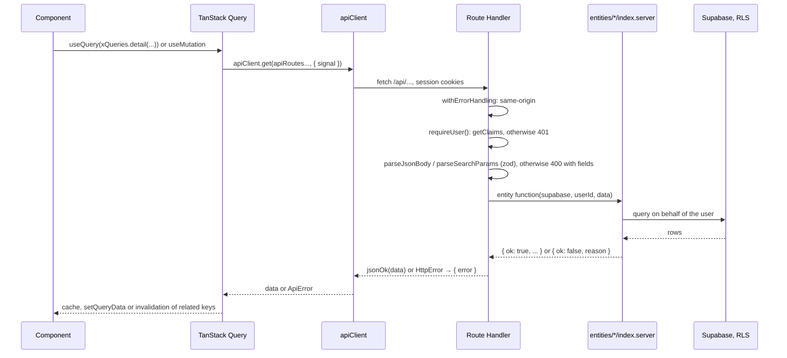
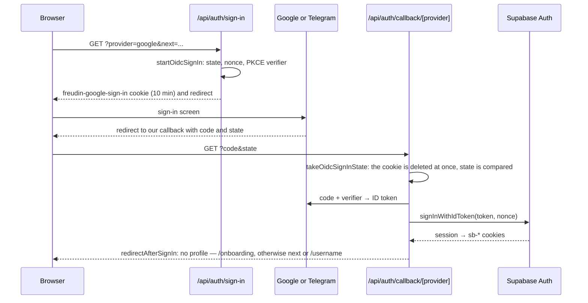
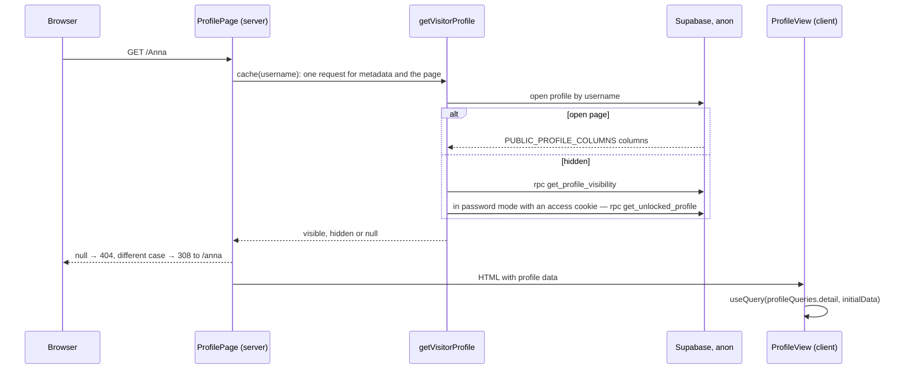
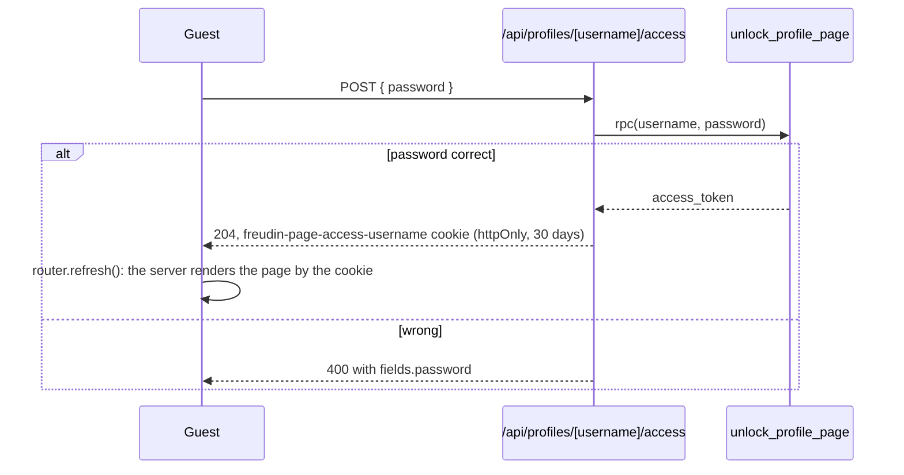
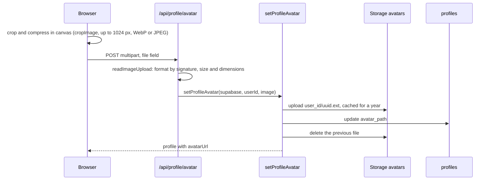

# Dynamic views — Freudin

A supplementary C4 view: runtime interactions of specific scenarios. Sequence diagrams connect
the browser, the server, the DB and the providers; this is not level L4. They complement the
[containers](2.containers.md) and [components](3.components.md). The internals of selected
components — [L4](4.code.md), files — the [code map](../code-map.md). The purpose of this view —
[Dynamic diagram in C4](https://c4model.com/diagrams/dynamic).

Module and import rules — [code.md](../workflows/code.md), client and server —
[api.md](../workflows/api.md), DB — [database.md](../workflows/database.md).

## Request from the browser to the API

- Query keys are `queryOptions` factories in the entity's `api` segment (`profileQueries`,
  `viewerQueries`, `usernameQueries`, `cityQueries`). The current user is `useViewerQuery()`,
  a guest is `null`.
- Profile mutations (`use-profile-mutations.ts`) put the response into the `/api/me` cache and
  the public page cache (`profileQueries.detail`): the owner sees the edit at once, also after Back.
- `withErrorHandling` rejects with 403 a mutating request (not GET, HEAD, OPTIONS) from another
  site: `Sec-Fetch-Site` is not `same-origin` or `Origin` is foreign. Requests without both
  headers (curl, webhooks) pass. It turns `HttpError` into a response with its status and
  anything else into a 500.
- On the client, `ApiError` can occur without a server response: `network_error` (no network or
  a 30 s timeout, file uploads 120 s) and `unexpected_response`.
- The form puts field errors from the server (`ApiError.fields`) into the fields'
  `errorMap.onSubmit` (`toFormFieldName`: `a.0.b` → `a[0].b`).

## Sign-in with Google and Telegram

Sign-in goes without Supabase OAuth, so the provider screen shows our site rather than
`<ref>.supabase.co`. Code — `entities/viewer/api/oidc-sign-in.server.ts`.

- Supabase recognises the user by the token's `sub`, so accounts created earlier through
  Supabase OAuth stayed the same.
- Telegram does not accept `http://`, so on localhost (`getOidcProvider`) and for Facebook
  sign-in goes through Supabase OAuth: `getOAuthSignInUrl` → provider → Supabase →
  `/api/auth/callback` → `exchangeAuthCode`. After Facebook, the server takes the 512×512 photo
  from the Graph API.
- Provider errors are translated into the codes in `entities/viewer/config/auth-errors.ts` and
  shown on `/login?error=`. The `next` path goes through `getSafeRedirectPath` (open redirect
  protection).
- The list of buttons on `/login` and the allowed providers — `enabledAuthProviders`.

### Provider specifics

- **Telegram.** The code is exchanged for tokens with the secret in a Basic header. The token
  endpoint returns errors with status 200, so the response is parsed by its fields. On
  localhost sign-in goes through Supabase OAuth, and the Telegram screen shows
  `<ref>.supabase.co`. The account is the same in both cases: the Client ID is shared, and the
  user's `sub` is the same. Telegram gives the name, username and photo but no email, so
  onboarding and settings show an optional contact email field. The page address suggestion
  (`getProfileSuggestions`): the provider's username, otherwise the name in Latin letters
  (`transliterate`), as a last resort the part of the email before «@».
- **Facebook** (disabled, see README). `/api/auth/sign-in?provider=facebook` → Supabase →
  Facebook → `https://<ref>.supabase.co/auth/v1/callback` → `/api/auth/callback`, the PKCE
  verifier in the `sb-…-code-verifier` cookie. Supabase treats the email from Facebook as
  verified: if it matches the Google account email, the sign-in lands in the same account.
  Sign-in without an email is allowed by a Supabase setting; if it is turned off, `/login`
  shows `email_required`.
- **Facebook photo.** Supabase stores a 50×50 photo, and a signed link cannot be enlarged. So
  `/api/auth/sign-in` passes `provider=facebook` in the return address, and the callback uses the
  Facebook token to get a 512×512 photo link from the Graph API and stores it in
  `user_metadata.facebook_avatar_url`: this way a sign-in through another provider does not
  overwrite it.

### Linking a sign-in method

`POST /api/auth/identities` with `{ provider }` starts the same flow but puts `linkUserId` into
the attempt cookie: the callback calls `completeOidcLink` (`linkIdentity` by ID token) only for
the user who started the linking. Other providers link through Supabase OAuth and
`/api/auth/callback?mode=link`. The result returns to
`/settings?section=account&linked=<provider>` or `&link_error=<code>`. Unlinking —
`DELETE /api/auth/identities/[provider]`; the last connected method cannot be unlinked
(`canUnlinkSignInMethod`). A disabled provider (currently Facebook) is not visible in settings
and does not count as a sign-in method: with Facebook linked, the only Google or Telegram
method cannot be unlinked.

A method already linked to another Freudin account gives `identity_already_exists`: accounts
are not merged, the second one has to be deleted. An account without a page has a delete button
in onboarding.

## Profile page `/<username>`

- `generateMetadata`: the name in `title`, the start of the description in `description`, the
  photo in Open Graph (without a photo — the site image). A hidden page has no name or photo
  and gets `noindex`.
- The server does not know the owner (a guest client without session cookies). `ProfileView`
  detects the owner through `/api/me`, and `HiddenProfileView` shows the owner their page from
  `/api/me`.
- `/demo` serves a demo profile from code (`config/demo-profile.ts`), without the database.

## Hidden page

- `updateProfile` writes the mode and password through `set_profile_visibility`: the same
  password keeps the token, a new one issues a new token and closes access for old cookies.
- The password is stored in plain text (the user's decision of 03.10.2026) in
  `profile_page_access` and visible only to the owner. There is no brute-force protection: it
  is a soft lock.
- Storage files are public: direct links to photos and documents obtained before hiding keep
  working.

## Photos and documents

- The server downloads a provider photo (`{ "source": "provider" }`) itself
  (`fetchProviderAvatar`) and checks it the same way.
- Document: the browser shrinks the image to 2048 px and makes a preview up to 480 px; the
  server uploads both files, then appends the document to the jsonb list `profiles.documents`
  with an `updated_at` check (protection against a race between two tabs). On failure the
  files are deleted.
- A new file always gets a new name (uuid), so the one-year cache is safe.
- An error deleting a leftover file is only logged: it does not break the profile.

## Saving the profile

- The form (TanStack Form) is validated by the same zod schema as the API:
  `profileInputSchema` in onboarding, `profileUpdateSchema` on the server for `PATCH`.
- In settings the form sends only the changes: `getProfileChanges(saved, input)`. Related
  fields go as a group (`linkedFieldGroups`): country, city and work formats; links, contacts
  and the preferred contact method; client categories, concerns and services; hiding mode and
  password.
- `updateProfile` writes in order: the contact email (`account_contacts`), private data
  (`profile_private`), the hiding mode (`set_profile_visibility`), then the `profiles` columns.
  A username uniqueness violation is `username_taken` (409), a foreign city `city_invalid` (400).
- The editor preview is built from the form values (`toPreviewProfile`) without a server request.
- Switching settings sections keeps the same form mounted. Leaving with the browser Back
  button stores its field values in `useSettingsDraftStore` in tab memory, scoped to the user;
  reloading clears this draft. A successful Save recreates the form from the updated query data.
- A link leaving settings opens Save and continue / Discard changes / Stay. Save and continue
  navigates only after a successful save; validation or API errors keep the draft. Discard
  resets the form before navigation. Closing or reloading the tab uses the browser warning.
- Selecting an editor block scrolls the preview to that block; typing does not scroll it.
  Mobile Edit and Preview keep separate scroll positions. Search details has no preview.
- CHECK constraints and the `is_valid_profile_*` functions in the database mirror the zod limits.

## Account deletion

`DELETE /api/me` with `{ username }` (confirmation; not needed without a profile):

1. `removeUserAvatarFiles` and `removeUserDocumentFiles` (admin client): first clear the links
   in the profile, then delete the files from Storage — on failure the profile does not point
   to nothing.
2. `deleteUser`: the user is deleted through the admin API; `profiles`, `profile_private` and
   `account_contacts` go by cascade.
3. Session cookies are cleared, the response is 204; the client fully reloads to the home page.

## Browser state

| What | Where it lives |
|---|---|
| Data from `/api` | Only TanStack Query (`staleTime` 60 s) |
| Onboarding draft | Zustand `useOnboardingDraftStore`, `sessionStorage` |
| Collapsed settings blocks | Zustand `useCollapsedBlocksStore`, `localStorage` per user id |
| Hidden «Finish your page» checklist | Zustand `useChecklistStore`, `localStorage` per username |
| Settings section | `?section=` in the URL; the form and its edits survive a section change |
| Unsaved settings edits after Back | Zustand `useSettingsDraftStore`, memory only (lost on reload) |
| Theme | next-themes, the `.dark` class on `<html>` |

After sign-out the page fully reloads to the home page: this resets the query cache and the
user state.
