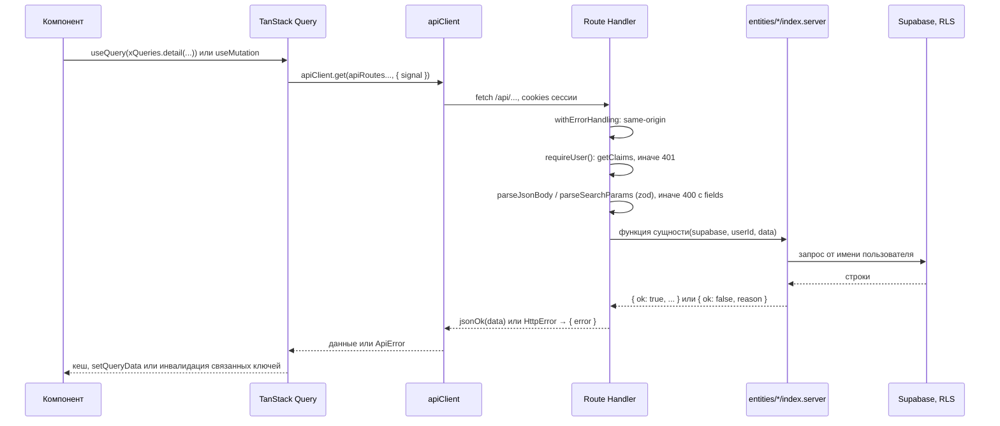
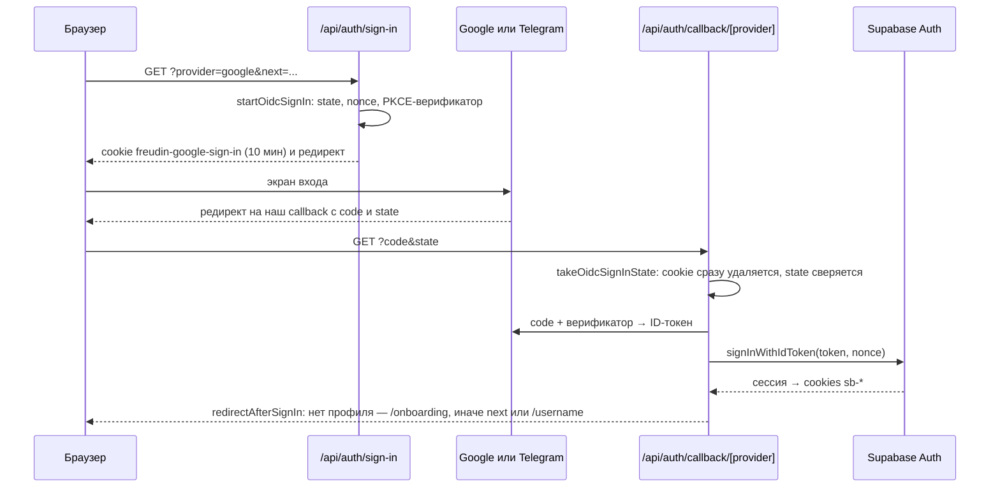
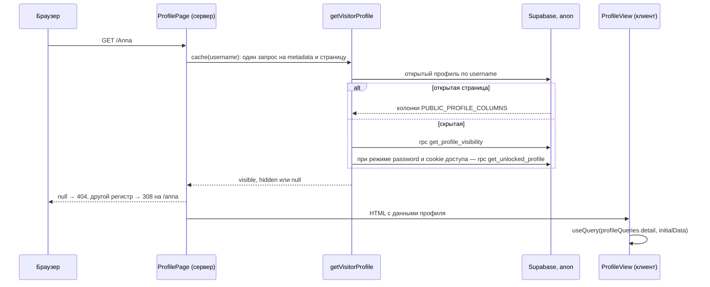
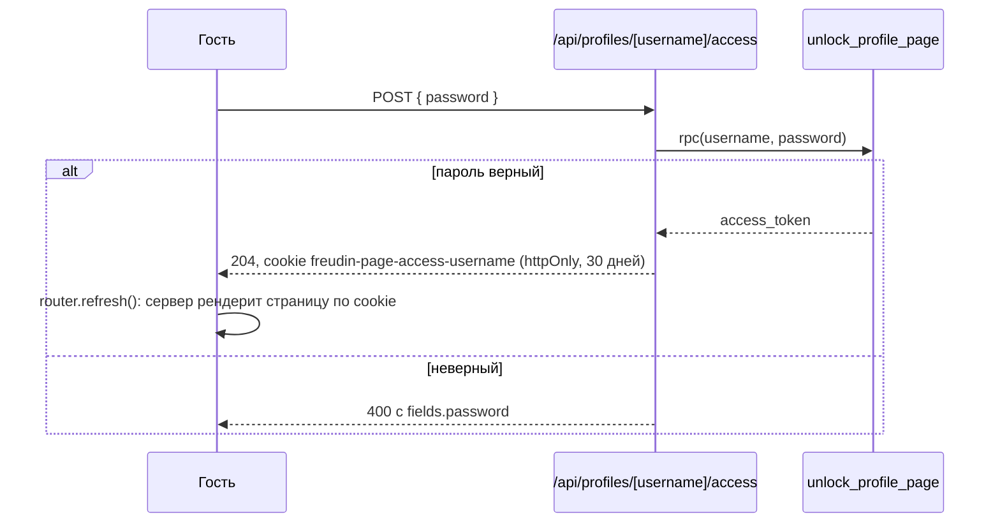
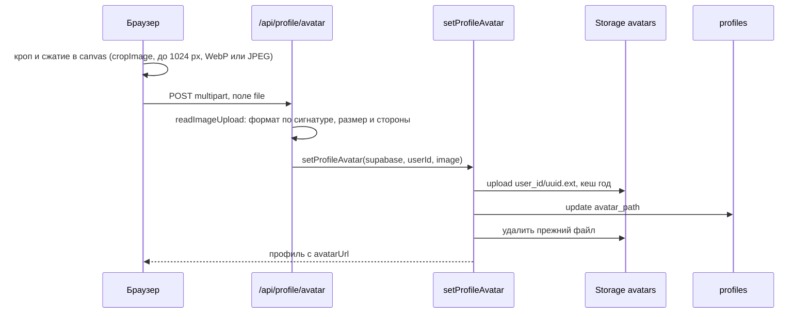

# Динамические представления — Freudin

Дополнительное представление C4: взаимодействия во время выполнения конкретных сценариев.
Диаграммы последовательностей связывают браузер, сервер, БД и провайдеров; это не уровень L4.
Они дополняют [контейнеры](2.containers.md) и [компоненты](3.components.md).
Внутреннее устройство выбранных компонентов — [L4](4.code.md), файлы — [карта кода](../code-map.md).
Назначение представления — [Dynamic diagram в C4](https://c4model.com/diagrams/dynamic).

Правила модулей и импортов — [code.md](../workflows/code.md), клиента и сервера —
[api.md](../workflows/api.md), БД — [database.md](../workflows/database.md).

## Запрос из браузера к API

- Ключи запросов — фабрики `queryOptions` в сегменте `api` сущности (`profileQueries`,
  `viewerQueries`, `usernameQueries`, `cityQueries`). Текущий пользователь — `useViewerQuery()`,
  гость — `null`.
- Мутации профиля (`use-profile-mutations.ts`) кладут ответ в кеш `/api/me` и публичной страницы
  (`profileQueries.detail`): владелец сразу видит правку и после «Назад».
- `withErrorHandling` отклоняет с 403 изменяющий запрос (не GET, HEAD, OPTIONS) с чужого сайта:
  `Sec-Fetch-Site` не `same-origin` или чужой `Origin`. Запросы без обоих заголовков (curl,
  вебхуки) проходят. `HttpError` он превращает в ответ с её статусом, остальное — в 500.
- `ApiError` на клиенте бывает и без ответа сервера: `network_error` (нет сети или таймаут 30 с,
  загрузка файлов — 120 с) и `unexpected_response`.
- Ошибки полей с сервера (`ApiError.fields`) форма кладёт в `errorMap.onSubmit` полей
  (`toFormFieldName`: `a.0.b` → `a[0].b`).

## Вход через Google и Telegram

Вход идёт без OAuth Supabase, чтобы на экране провайдера был виден наш сайт, а не
`<ref>.supabase.co`. Код — `entities/viewer/api/oidc-sign-in.server.ts`.

- Supabase узнаёт пользователя по `sub` токена, поэтому аккаунты, созданные раньше через OAuth
  Supabase, остались прежними.
- Telegram не принимает `http://`, поэтому на localhost (`getOidcProvider`) и для Facebook вход
  идёт через OAuth Supabase: `getOAuthSignInUrl` → провайдер → Supabase → `/api/auth/callback`
  → `exchangeAuthCode`. После Facebook сервер берёт фото 512×512 из Graph API.
- Ошибки провайдера переводятся в коды `entities/viewer/config/auth-errors.ts` и показываются
  на `/login?error=`. Путь `next` проходит через `getSafeRedirectPath` (защита от open redirect).
- Список кнопок на `/login` и допустимых провайдеров — `enabledAuthProviders`.

### Особенности провайдеров

- **Telegram.** Код меняется на токены с секретом в заголовке Basic. Ошибки токен-эндпоинт
  отдаёт со статусом 200, поэтому ответ разбирается по полям. На localhost вход идёт через
  OAuth Supabase, и на экране Telegram виден `<ref>.supabase.co`. Аккаунт в обоих случаях один:
  Client ID общий, `sub` у пользователя тот же. Telegram передаёт имя, username и фото, email —
  нет, поэтому онбординг и настройки показывают необязательное поле контактной почты.
  Подсказка адреса страницы (`getProfileSuggestions`): username провайдера, иначе имя латиницей
  (`transliterate`), в последнюю очередь часть email до «@».
- **Facebook** (выключен, см. README). `/api/auth/sign-in?provider=facebook` → Supabase →
  Facebook → `https://<ref>.supabase.co/auth/v1/callback` → `/api/auth/callback`,
  PKCE-верификатор — в cookie `sb-…-code-verifier`. Email от Facebook Supabase считает
  подтверждённым: совпал с email аккаунта Google — вход попадает в тот же аккаунт. Без email
  вход разрешён настройкой Supabase; если её выключить, `/login` покажет `email_required`.
- **Фото Facebook.** Supabase сохраняет фото 50×50, а подписанную ссылку увеличить нельзя.
  Поэтому `/api/auth/sign-in` передаёт в адресе возврата `provider=facebook`, и колбэк по токену
  Facebook берёт у Graph API ссылку на фото 512×512 и кладёт её
  в `user_metadata.facebook_avatar_url`: так вход через другого провайдера её не перезапишет.

### Привязка способа входа

`POST /api/auth/identities` с `{ provider }` начинает тот же поток, но кладёт в cookie попытки
`linkUserId`: колбэк вызывает `completeOidcLink` (`linkIdentity` по ID-токену) только для
пользователя, который начал привязку. Остальные провайдеры привязываются через OAuth Supabase
и `/api/auth/callback?mode=link`. Итог возвращается в
`/settings?section=account&linked=<provider>` или `&link_error=<code>`. Отвязка —
`DELETE /api/auth/identities/[provider]`; последний подключённый способ отвязать нельзя
(`canUnlinkSignInMethod`). Отключённый провайдер (сейчас Facebook) в настройках не виден
и способом входа не считается: при привязанном Facebook отвязать единственный Google или
Telegram нельзя.

Способ, уже привязанный к другому аккаунту Freudin, даёт ошибку `identity_already_exists`:
аккаунты не объединяются, второй нужно удалить. У аккаунта без страницы кнопка удаления есть
на онбординге.

## Личная страница `/<username>`

- `generateMetadata`: имя в `title`, начало описания в `description`, фото в Open Graph
  (без фото — картинка сайта). У скрытой страницы нет имени и фото, `noindex`.
- Владельца сервер не знает (гостевой клиент без cookies сессии). `ProfileView` отмечает
  владельца по `/api/me`, а `HiddenProfileView` показывает владельцу его страницу из `/api/me`.
- `/demo` отдаёт демо-профиль из кода (`config/demo-profile.ts`), без базы.

## Скрытая страница

- Режим и пароль пишет `updateProfile` через `set_profile_visibility`: тот же пароль токен
  не меняет, новый — выпускает новый токен и закрывает доступ старым cookie.
- Пароль хранится открытым текстом (решение пользователя 03.10.2026) в `profile_page_access`
  и виден только владельцу. Защиты от перебора нет: это мягкий замок.
- Файлы в Storage публичные: прямые ссылки на фото и документы, полученные до скрытия, работают.

## Фото и документы

- Фото провайдера (`{ "source": "provider" }`) сервер скачивает сам (`fetchProviderAvatar`)
  и проверяет так же.
- Документ: браузер уменьшает картинку до 2048 px и делает превью до 480 px; сервер загружает
  оба файла, затем дописывает документ в jsonb-список `profiles.documents` с проверкой
  `updated_at` (защита от гонки двух вкладок). Сбой — файлы удаляются.
- Новый файл всегда получает новое имя (uuid), поэтому кеш на год безопасен.
- Ошибку удаления лишнего файла только логируем: она не ломает профиль.

## Сохранение профиля

- Форма (TanStack Form) валидируется той же zod-схемой, что и API: `profileInputSchema`
  на онбординге, `profileUpdateSchema` на сервере для `PATCH`.
- В настройках форма отправляет только изменения: `getProfileChanges(saved, input)`.
  Связанные поля уходят группой (`linkedFieldGroups`): страна, город и форматы работы; ссылки,
  контакты и предпочтительный способ связи; категории клиентов, запросы и услуги; режим
  скрытия и пароль.
- `updateProfile` пишет по порядку: контактная почта (`account_contacts`), приватные данные
  (`profile_private`), режим скрытия (`set_profile_visibility`), затем колонки `profiles`.
  Нарушение уникальности username — `username_taken` (409), чужой город — `city_invalid` (400).
- Превью в редакторе строится из значений формы (`toPreviewProfile`) без запроса к серверу.
- CHECK-ограничения и функции `is_valid_profile_*` в базе повторяют лимиты zod-схем.

## Удаление аккаунта

`DELETE /api/me` с `{ username }` (подтверждение; без профиля не нужно):

1. `removeUserAvatarFiles` и `removeUserDocumentFiles` (admin-клиент): сначала обнуляют ссылки
   в профиле, потом удаляют файлы из Storage — при сбое профиль не ссылается на пустоту.
2. `deleteUser`: пользователь удаляется через admin API, `profiles`, `profile_private`
   и `account_contacts` — каскадом.
3. Cookies сессии стираются, ответ 204; клиент полностью перезагружает страницу на главную.

## Состояние в браузере

| Что | Где живёт |
|---|---|
| Данные из `/api` | Только TanStack Query (`staleTime` 60 с) |
| Черновик онбординга | Zustand `useOnboardingDraftStore`, `sessionStorage` |
| Свёрнутые блоки настроек | Zustand `useCollapsedBlocksStore`, `localStorage` по id пользователя |
| Скрытый чек-лист «Finish your page» | Zustand `useChecklistStore`, `localStorage` по username |
| Раздел настроек | `?section=` в адресе; смена раздела пересоздаёт форму |
| Тема | next-themes, класс `.dark` на `<html>` |

После выхода страница полностью перезагружается на главную: так сбрасываются кеш запросов
и состояние пользователя.
