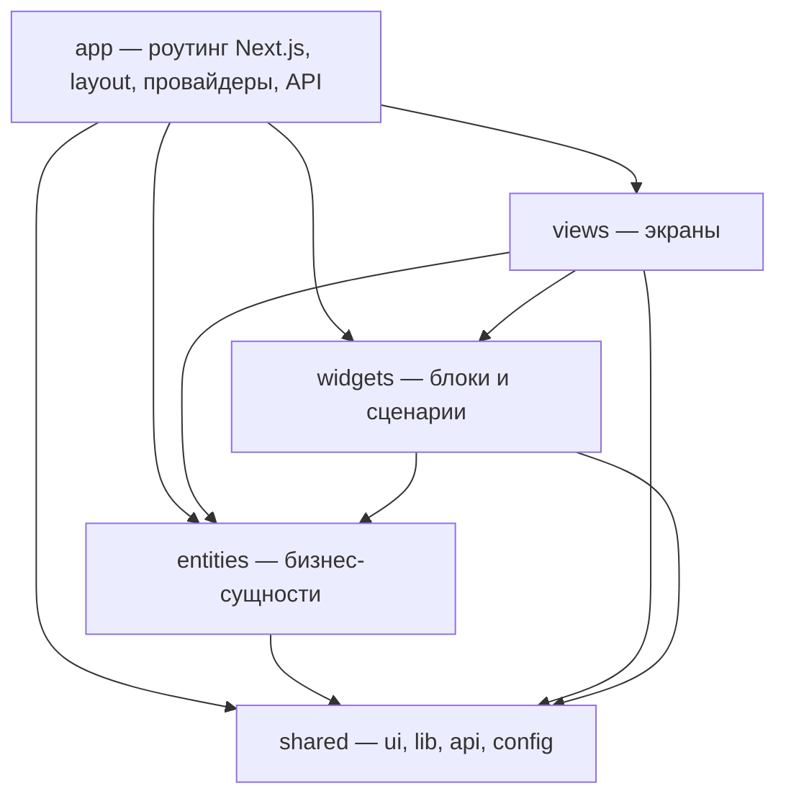
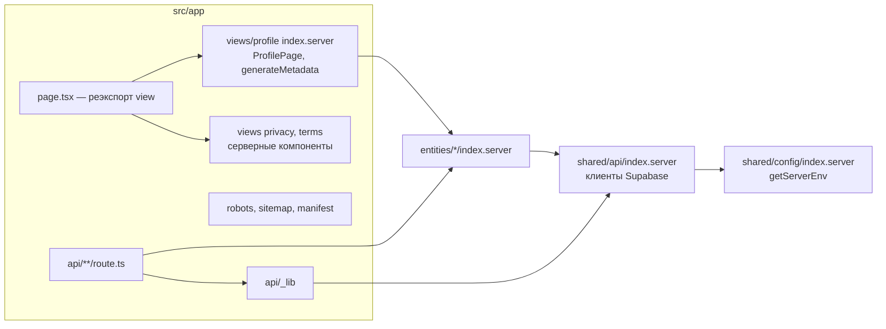

# Карта поиска по коду — Freudin

Навигация по сценариям, FSD-слайсам, public API и реализации. Этот документ не является
уровнем C4. Статические компоненты и их связи — [L3](architecture/3.components.md),
внутреннее устройство выбранных компонентов — [L4](architecture/4.code.md),
сквозные сценарии — [динамические представления](architecture/dynamic.md).

## Где искать изменение

Выбери сценарий, открой карточку модуля и нужный файл. Это точки входа для чтения;
межслайсовые импорты по-прежнему идут только через public API, см. [правила](workflows/code.md).

| Сценарий | Модули и порядок чтения |
|---|---|
| Save профиля, ошибка или частичный успех | [settings](#views-settings) → [мутации viewer](#entities-viewer) → [запись profile](#entities-profile); [поток сохранения](architecture/dynamic.md#сохранение-профиля) |
| Несохранённое превью | [profile-form](#widgets-profile-form) → [preview-profile.ts](../src/entities/profile/lib/preview-profile.ts) → [profile-card](#widgets-profile-card) |
| Навигация и черновики | [settings](#views-settings), [onboarding](#views-onboarding), [use-unsaved-changes-warning.ts](../src/shared/lib/use-unsaved-changes-warning.ts) |
| Гостевой доступ, пароль, настоящий 404 | [views/profile](#views-profile) → [visitor-profile.server.ts](../src/entities/profile/api/visitor-profile.server.ts); [поток доступа](architecture/dynamic.md#скрытая-страница) |
| Вход, привязка, отвязка и удаление аккаунта | [viewer](#entities-viewer) и [account-settings](#widgets-account-settings); [поток входа](architecture/dynamic.md#вход-через-google-и-telegram) |
| Поля практики, связанные значения и цены | [схемы profile](#entities-profile), [форма](#widgets-profile-form), [карточка](#widgets-profile-card) |
| Фото и документы | [сервер profile](#entities-profile), [profile-documents](#widgets-profile-documents); [поток файлов](architecture/dynamic.md#фото-и-документы) |
| Страны, города и поиск по справочнику | [location](#entities-location); ключ поиска — [transliterate.ts](../src/shared/lib/transliterate.ts) |
| Обложка, тема, порядок блоков и Highlight | [profile-form](#widgets-profile-form), [profile-card](#widgets-profile-card), [UI и токены](#shared-ui) |
| Ошибки API, сессия и валидация HTTP | [api/_lib](../src/app/api/_lib/index.ts), [shared/api](#shared-api); [поток API](architecture/dynamic.md#запрос-из-браузера-к-api) |
| Маршрут, env, реквизиты и адрес сайта | [shared/config](#shared-config), [роуты README](../README.md#роуты) |

## Слои кода

Браузерное приложение и Next.js-сервер собираются из одного кода `src/`, организованного по
Feature-Sliced Design с поправками: вместо `pages` — `views`, слоя `features` нет (сценарии
собираются в `widgets`, их мутации живут в `entities`). Модуль импортирует только слои ниже
своего; Biome проверяет это правилом `noRestrictedImports`.

Слайсы с клиентской и серверной частями разделяют public API: `index.ts` и
`index.server.ts` (`import "server-only"`). У `entities/social-link` серверного API нет;
`views/profile` предоставляет только `index.server.ts`. У юридических view `index.ts`
экспортирует серверные компоненты. Фактические границы перечислены в каталоге ниже.

## Связывание файлов Next.js

Схема организации исходников и реэкспортов; это не компонентная диаграмма C4.

## Каталог слайсов

Каталог отвечает, **где искать поведение и какие границы сохранить**. Полный набор экспортов,
типов, пропов, лимитов и значений смотри в указанных файлах; здесь они не дублируются.

Обновляй карточку, если поменялись ответственность, public API-путь, ключевая точка входа
или существенное ограничение. Добавление обычного экспорта не требует переписывать каталог.
Изменение ответственности и связей компонентов отражай в [L3](architecture/3.components.md),
внутренней структуры выбранного компонента — в [L4](architecture/4.code.md),
последовательности взаимодействий — в [динамических представлениях](architecture/dynamic.md).
Символ ищи в public API через `rg -n`, затем открывай указанный там файл реализации;
для связи сущностей сначала проверь `@x`, не создавай второй модуль с той же задачей.

### Сущности

#### entities/viewer

- **Зона:** текущий пользователь, вход и способы входа, мутации аккаунта и профиля.
- **API:** [index.ts](../src/entities/viewer/index.ts),
  [index.server.ts](../src/entities/viewer/index.server.ts).
- **Искать:** [OIDC](../src/entities/viewer/api/oidc-sign-in.server.ts),
  [OAuth и удаление](../src/entities/viewer/api/auth.server.ts),
  [привязки](../src/entities/viewer/api/identities.server.ts),
  [мутации профиля и их кеш](../src/entities/viewer/api/use-profile-mutations.ts).
- **Граница:** мутации профиля находятся здесь, запись данных — в `entities/profile`.
  Список доступных провайдеров — [auth-providers.ts](../src/entities/viewer/config/auth-providers.ts);
  отвязку последнего доступного способа запрещает
  [can-unlink-sign-in-method.ts](../src/entities/viewer/lib/can-unlink-sign-in-method.ts).

#### entities/profile

- **Зона:** профиль и username, публичные и приватные данные, файлы, видимость страницы.
- **API:** [index.ts](../src/entities/profile/index.ts),
  [index.server.ts](../src/entities/profile/index.server.ts),
  [связи с другими сущностями](../src/entities/profile/@x).
- **Поля и контракт:** [schemas.ts](../src/entities/profile/model/schemas.ts),
  [types.ts](../src/entities/profile/model/types.ts),
  [username.ts](../src/entities/profile/model/username.ts),
  [справочники и лимиты](../src/entities/profile/config).
- **Сохранение и превью:** [profile-changes.ts](../src/entities/profile/lib/profile-changes.ts),
  [preview-profile.ts](../src/entities/profile/lib/preview-profile.ts),
  [profile.server.ts](../src/entities/profile/api/profile.server.ts).
- **Доступ и файлы:** [visitor-profile.server.ts](../src/entities/profile/api/visitor-profile.server.ts),
  [page-access.server.ts](../src/entities/profile/api/page-access.server.ts),
  [avatar.server.ts](../src/entities/profile/api/avatar.server.ts),
  [document.server.ts](../src/entities/profile/api/document.server.ts).
- **Граница:** `PUBLIC_PROFILE_COLUMNS` ограничивает гостевое чтение. Приватные данные и пароль
  не попадают в превью; документы в нём подставляет view отдельно. Группы PATCH определяет
  `linkedFieldGroups` в схемах; правила БД — [database.md](workflows/database.md).
  Текущий порядок записи и частичный успех фото описаны в [потоке сохранения](architecture/dynamic.md#сохранение-профиля).

#### entities/location

- **Зона:** справочник стран и поиск городов.
- **API:** [index.ts](../src/entities/location/index.ts),
  [index.server.ts](../src/entities/location/index.server.ts),
  [@x/profile.ts](../src/entities/location/@x/profile.ts).
- **Искать:** [city-queries.ts](../src/entities/location/api/city-queries.ts),
  [city.server.ts](../src/entities/location/api/city.server.ts),
  [countries.ts](../src/entities/location/config/countries.ts).
- **Граница:** город берётся из справочника; поиск использует `cities.search_name` и
  [toSearchKey](../src/shared/lib/transliterate.ts). Пересборка справочника — по правилам БД.

#### entities/social-link

- **Зона:** платформы, нормализация ссылок, подписи и кнопки ссылок.
- **API:** [index.ts](../src/entities/social-link/index.ts),
  [@x/profile.ts](../src/entities/social-link/@x/profile.ts); серверного API нет.
- **Искать:** [schema.ts](../src/entities/social-link/model/schema.ts),
  [normalize.ts](../src/entities/social-link/model/normalize.ts),
  [social-link-button.tsx](../src/entities/social-link/ui/social-link-button.tsx),
  [platform-icon.tsx](../src/entities/social-link/ui/platform-icon.tsx).
- **Граница:** свой заголовок необязателен; старые записи без него продолжают читаться.
  Логотипы платформ — SVG в коде (simple-icons, CC0), отдельная библиотека для них не установлена.

### Виджеты

#### widgets/profile-form

- **Зона:** общая форма онбординга и настроек, разделы, сворачивание, Save и превью.
- **API:** [index.ts](../src/widgets/profile-form/index.ts).
- **Искать:** [profile-form.tsx](../src/widgets/profile-form/ui/profile-form.tsx),
  [sortable-blocks.tsx](../src/widgets/profile-form/ui/sortable-blocks.tsx),
  [appearance-block.tsx](../src/widgets/profile-form/ui/appearance-block.tsx),
  [block-summary.ts](../src/widgets/profile-form/lib/block-summary.ts),
  [avatar-value.ts](../src/widgets/profile-form/model/avatar-value.ts).
- **Граница:** скрытые разделы и свёрнутые блоки остаются в DOM; ошибка раскрывает нужный блок.
  Закрытые поля не попадают в сводку. В Account свой Save; немедленные операции документов
  и аккаунта — отдельные виджеты. Пересоздание формы при смене раздела управляется `views/settings`.

#### widgets/profile-card

- **Зона:** содержимое визитки и холст её оформления, общие для страницы и превью.
- **API:** [index.ts](../src/widgets/profile-card/index.ts).
- **Сборка:** [profile-card.tsx](../src/widgets/profile-card/ui/profile-card.tsx),
  [profile-canvas.tsx](../src/widgets/profile-card/ui/profile-canvas.tsx),
  [page-cover.tsx](../src/widgets/profile-card/ui/page-cover.tsx).
- **Блоки и действия:** [практика](../src/widgets/profile-card/ui/practice-details.tsx),
  [услуги](../src/widgets/profile-card/ui/service-list.tsx),
  [FAQ](../src/widgets/profile-card/ui/faq-list.tsx),
  [документы](../src/widgets/profile-card/ui/document-gallery.tsx),
  [контактная кнопка](../src/widgets/profile-card/ui/preferred-contact-button.tsx),
  [чек-лист](../src/widgets/profile-card/ui/owner-checklist.tsx),
  [Share и QR](../src/widgets/profile-card/ui/share-profile-button.tsx).
- **Граница:** `isPreview` скрывает Share, Edit и чек-лист владельца, имя не становится `h1`.
  Скрытие чек-листа хранится отдельно в [model](../src/widgets/profile-card/model/checklist-store.ts).
  Порядок задаёт профиль, пустые блоки скрываются; закрытые ответы FAQ сейчас не входят в серверный HTML.
  Пресет меняет холст, но не рамку сайта; фиксированная контактная кнопка учитывает рамку превью.

#### widgets/profile-documents

- **Зона:** загрузка, список и удаление документов психолога.
- **API:** [index.ts](../src/widgets/profile-documents/index.ts).
- **Искать:** [profile-documents.tsx](../src/widgets/profile-documents/ui/profile-documents.tsx),
  [prepare-document-images.ts](../src/widgets/profile-documents/lib/prepare-document-images.ts).
- **Граница:** загрузка и удаление сохраняются сразу, независимо от Save формы профиля.
  Полный файл и миниатюра готовятся отдельно; подпись обязательна, удаление требует подтверждения.

#### widgets/account-settings

- **Зона:** способы входа, выход и удаление аккаунта.
- **API:** [index.ts](../src/widgets/account-settings/index.ts).
- **Искать:** [sign-in-methods.tsx](../src/widgets/account-settings/ui/sign-in-methods.tsx),
  [delete-account-dialog.tsx](../src/widgets/account-settings/ui/delete-account-dialog.tsx).
- **Граница:** видны только включённые провайдеры; удаление аккаунта с профилем подтверждается
  username, для аккаунта без страницы username не нужен. Заголовок Account рисует view.

#### widgets/sign-in-panel

- **Зона:** кнопки входа и состояние перехода к провайдеру.
- **API:** [index.ts](../src/widgets/sign-in-panel/index.ts).
- **Искать:** [sign-in-panel.tsx](../src/widgets/sign-in-panel/ui/sign-in-panel.tsx).
- **Граница:** доступные провайдеры, подписи ошибок и логотипы приходят из `entities/viewer`.

#### widgets/header и widgets/footer

- **Зона:** шапка, меню пользователя, юридические ссылки, почта поддержки и реквизиты ИП.
- **API:** [header/index.ts](../src/widgets/header/index.ts),
  [footer/index.ts](../src/widgets/footer/index.ts).
- **Искать:** [user-menu.tsx](../src/widgets/header/ui/user-menu.tsx),
  [header.tsx](../src/widgets/header/ui/header.tsx),
  [footer.tsx](../src/widgets/footer/ui/footer.tsx).
- **Граница:** на `/settings` шапка и подвал не рисуются; реквизиты берутся из `legalConfig`,
  годы copyright — из [use-copyright-years.ts](../src/widgets/footer/lib/use-copyright-years.ts).

#### widgets/legal-document

- **Зона:** оформление юридических страниц и реквизиты оператора.
- **API:** [index.ts](../src/widgets/legal-document/index.ts).
- **Искать:** [legal-document.tsx](../src/widgets/legal-document/ui/legal-document.tsx),
  [operator-details.tsx](../src/widgets/legal-document/ui/operator-details.tsx).
- **Граница:** серверные компоненты без клиентского JS; реквизиты из `shared/config`.

### Экраны

Тонкие файлы `src/app/**/page.tsx` реэкспортируют view. Public API перечислены в таблице;
маршруты и доступ — в [README](../README.md#страницы), правила SSR — в [api.md](workflows/api.md).

| View | Public API | Ключевая реализация |
|---|---|---|
| `home` | [index.ts](../src/views/home/index.ts) | [home-view.tsx](../src/views/home/ui/home-view.tsx) |
| `login` | [index.ts](../src/views/login/index.ts) | [login-view.tsx](../src/views/login/ui/login-view.tsx) |
| `onboarding` | [index.ts](../src/views/onboarding/index.ts) | [onboarding-view.tsx](../src/views/onboarding/ui/onboarding-view.tsx) |
| `settings` | [index.ts](../src/views/settings/index.ts) | [settings-view.tsx](../src/views/settings/ui/settings-view.tsx) |
| `profile` | [index.server.ts](../src/views/profile/index.server.ts) | [profile-page.server.tsx](../src/views/profile/ui/profile-page.server.tsx) |
| `privacy` | [index.ts](../src/views/privacy/index.ts) | [privacy-view.tsx](../src/views/privacy/ui/privacy-view.tsx) |
| `terms` | [index.ts](../src/views/terms/index.ts) | [terms-view.tsx](../src/views/terms/ui/terms-view.tsx) |
| `not-found` | [index.ts](../src/views/not-found/index.ts) | [not-found-view.tsx](../src/views/not-found/ui/not-found-view.tsx) |
| `error` | [index.ts](../src/views/error/index.ts) | [error-view.tsx](../src/views/error/ui/error-view.tsx) |

- **settings:** [settings-view.tsx](../src/views/settings/ui/settings-view.tsx) —
  сборка редактора, сохранение и синхронизация исходных значений формы.
  Раздел — `?section=`; `key` пересоздаёт форму при смене раздела и после Save.
  Сворачивание — [collapsed-blocks-store.ts](../src/views/settings/model/collapsed-blocks-store.ts),
  localStorage по пользователю. Последовательность Profile → Avatar находится во view, не в форме.

- **onboarding:** [onboarding-view.tsx](../src/views/onboarding/ui/onboarding-view.tsx) —
  создание профиля с превью и возможностью удалить аккаунт без страницы;
  черновик — [draft-store.ts](../src/views/onboarding/model/draft-store.ts), sessionStorage.

- **profile:** [profile-page.server.tsx](../src/views/profile/ui/profile-page.server.tsx) —
  серверная загрузка и metadata →
  [profile-view.tsx](../src/views/profile/ui/profile-view.tsx) с `initialData` TanStack Query.
  Скрытая страница — [hidden-profile-view.tsx](../src/views/profile/ui/hidden-profile-view.tsx)
  и [page-password-form.tsx](../src/views/profile/ui/page-password-form.tsx).
  Сервер читает как гость; владелец видит скрытую страницу из `/api/me`. Metadata скрытой страницы
  не раскрывает имя и фото, включает `noindex`. Полный поток — в [динамическом представлении](architecture/dynamic.md#личная-страница-username).

- **privacy / terms:** серверные тексты без клиентского JS; общая обёртка — `legal-document`.
- **error:** `error.tsx` и `global-error.tsx` передают `retry`; подробности —
  [правила Next.js](workflows/code.md#nextjs-16-на-что-обратить-внимание).

### Общие модули

#### shared/api

- **Зона:** HTTP-клиент, ошибки и QueryClient; серверные клиенты Supabase и типы БД.
- **API:** [index.ts](../src/shared/api/index.ts), [index.server.ts](../src/shared/api/index.server.ts).
- **Искать:** [api-client.ts](../src/shared/api/api-client.ts),
  [api-error.ts](../src/shared/api/api-error.ts), [query-client.ts](../src/shared/api/query-client.ts),
  [supabase/](../src/shared/api/supabase).
- **Граница:** клиентский API тянет TanStack Query; на сервере — `index.server.ts` или `import type`.
  Supabase импортируется только внутри `supabase/`; типы БД генерируются, не правятся вручную.

#### shared/config

- **Зона:** пути, адрес и настройки сайта, реквизиты, зарезервированные username, серверный env.
- **API:** [index.ts](../src/shared/config/index.ts),
  [index.server.ts](../src/shared/config/index.server.ts).
- **Искать:** [routes.ts](../src/shared/config/routes.ts), [site.ts](../src/shared/config/site.ts),
  [legal.ts](../src/shared/config/legal.ts), [env.server.ts](../src/shared/config/env.server.ts).
- **Граница:** env читается только на сервере; новый роут добавляется в `routes`, чтобы его
  первый сегмент стал зарезервированным. Значения цветов вне CSS — [theme.ts](../src/shared/config/theme.ts).

#### shared/ui

- **Зона:** shadcn и переиспользуемые компоненты без бизнес-логики; общего barrel API нет,
  импорт по файлу. Компоненты и истории — [каталог ui](../src/shared/ui).
- **Искать:** [container.tsx](../src/shared/ui/container.tsx),
  [section-nav.tsx](../src/shared/ui/section-nav.tsx),
  [disclosure-button.tsx](../src/shared/ui/disclosure-button.tsx),
  [combobox.tsx](../src/shared/ui/combobox.tsx), [sonner.tsx](../src/shared/ui/sonner.tsx).
- **Граница:** сворачивание через `hidden` сохраняет поля в DOM; `Combobox` поддерживает серверный поиск.
  Тема — [globals.css](../src/app/globals.css), шрифты — [fonts.ts](../src/app/fonts.ts),
  показ токенов — [tokens.stories.tsx](../src/shared/ui/tokens.stories.tsx).
  Правила компонентов и историй — [ui-kit.md](workflows/ui-kit.md), стилей — [ui.md](workflows/ui.md).

#### shared/lib

- **Зона:** утилиты без бизнес-логики; общего barrel API нет, импорт по файлу.
- **Искать:** [cn](../src/shared/lib/utils.ts), [cva](../src/shared/lib/cva.ts),
  [безопасный редирект](../src/shared/lib/safe-redirect.ts),
  [ошибки форм](../src/shared/lib/field-errors.ts),
  [кроп](../src/shared/lib/crop-image.ts), [canvas](../src/shared/lib/canvas-image.ts),
  [транслитерация и ключ поиска](../src/shared/lib/transliterate.ts).
- **Граница:** обработка картинок идёт через canvas до загрузки; особенности токенов `cn` и `cva` —
  в [правилах UI](workflows/ui.md). Проверки адреса возврата нельзя обходить прямым `next`.
