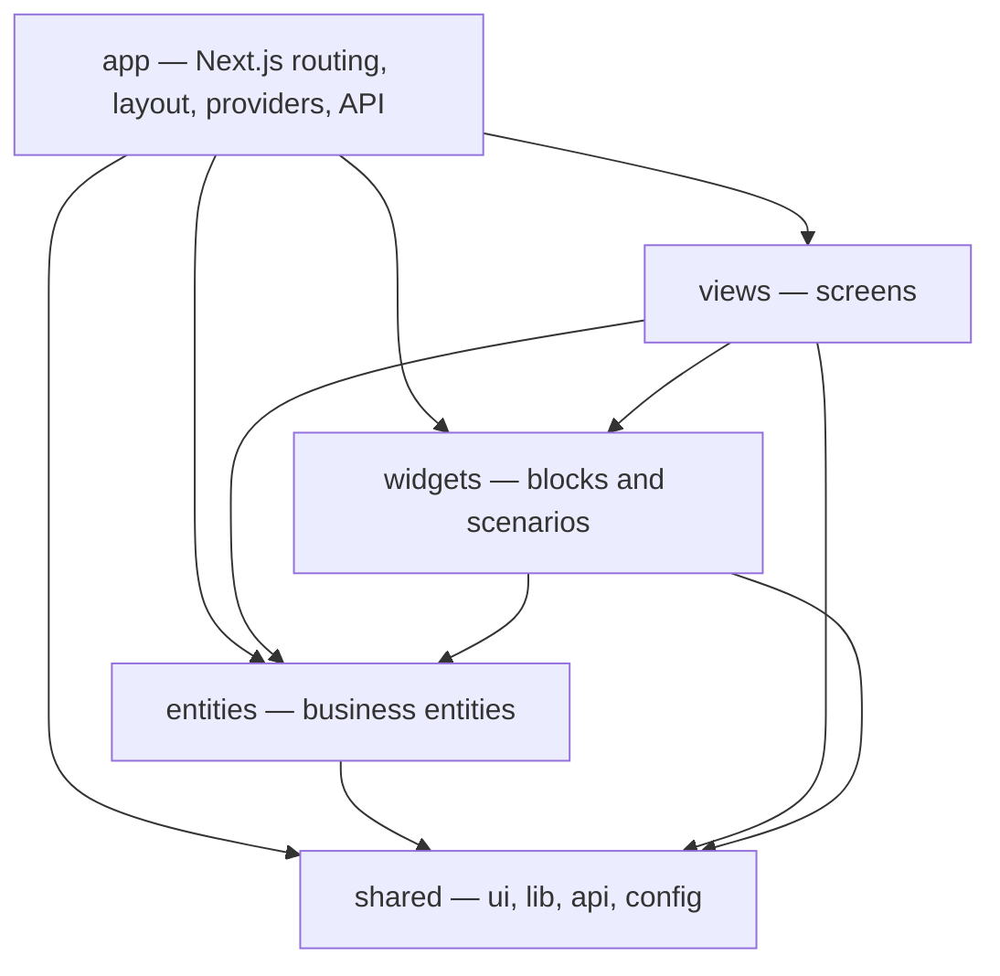
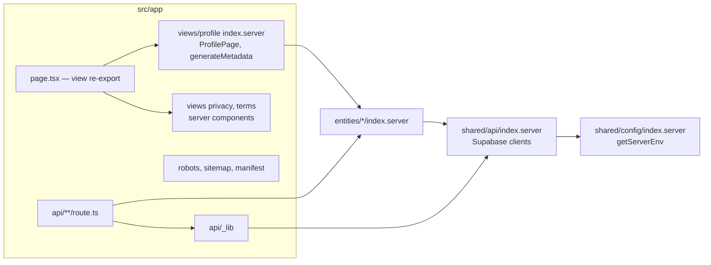

# Code lookup map — Freudin

Navigation by scenario, FSD slice, public API and implementation. This document is not a C4
level. Static components and their links — [L3](architecture/3.components.md), internals of
selected components — [L4](architecture/4.code.md), end-to-end scenarios —
[dynamic views](architecture/dynamic.md).

## Where to look for a change

Pick the scenario, open the module card and the needed file. These are entry points for
reading; cross-slice imports still go only through the public API, see the [rules](workflows/code.md).

| Scenario | Modules and reading order |
|---|---|
| Profile Save, an error or partial success | [settings](#views-settings) → [viewer mutations](#entities-viewer) → [profile writes](#entities-profile); [saving flow](architecture/dynamic.md#saving-the-profile) |
| Unsaved preview | [profile-form](#widgets-profile-form) → [preview-profile.ts](../src/entities/profile/lib/preview-profile.ts) → [profile-card](#widgets-profile-card) |
| Navigation and drafts | [settings](#views-settings), [onboarding](#views-onboarding), [use-unsaved-changes-warning.ts](../src/shared/lib/use-unsaved-changes-warning.ts) |
| Guest access, password, a real 404 | [views/profile](#views-profile) → [visitor-profile.server.ts](../src/entities/profile/api/visitor-profile.server.ts); [access flow](architecture/dynamic.md#hidden-page) |
| Sign-in, linking, unlinking and account deletion | [viewer](#entities-viewer) and [account-settings](#widgets-account-settings); [sign-in flow](architecture/dynamic.md#sign-in-with-google-and-telegram) |
| Practice fields, related values and prices | [profile schemas](#entities-profile), [form](#widgets-profile-form), [card](#widgets-profile-card) |
| Photos and documents | [profile server](#entities-profile), [profile-documents](#widgets-profile-documents); [file flow](architecture/dynamic.md#photos-and-documents) |
| Countries, cities and directory search | [location](#entities-location); search key — [transliterate.ts](../src/shared/lib/transliterate.ts) |
| Cover, theme, block order and Highlight | [profile-form](#widgets-profile-form), [profile-card](#widgets-profile-card), [UI and tokens](#shared-ui) |
| API errors, session and HTTP validation | [api/_lib](../src/app/api/_lib/index.ts), [shared/api](#shared-api); [API flow](architecture/dynamic.md#request-from-the-browser-to-the-api) |
| Route, env, operator details and site address | [shared/config](#shared-config), [README routes](../README.md#роуты) |

## Code layers

The browser application and the Next.js server are built from the same `src/`, organised by
Feature-Sliced Design with the amendments and import rules in [code.md](workflows/code.md).

Slices with client and server parts split their public API into `index.ts` and
`index.server.ts` (`import "server-only"`). `entities/social-link` has no server API;
`views/profile` provides only `index.server.ts`. For the legal views, `index.ts` exports server
components. The actual boundaries are listed in the catalog below.

## Wiring of Next.js files

How sources and re-exports are organised; this is not a C4 component diagram.

## Slice catalog

The catalog answers **where to look for behaviour and which boundaries to keep**. For the full
set of exports, types, props, limits and values, see the listed files; they are not copied here.

Update a card when its responsibility, public API path, key entry point or an essential
constraint changes. Adding an ordinary export does not require rewriting the catalog.
Reflect changes of component responsibilities and links in [L3](architecture/3.components.md),
of a selected component's internal structure in [L4](architecture/4.code.md), and of
interaction sequences in the [dynamic views](architecture/dynamic.md).
Look a symbol up in the public API with `rg -n`, then open the implementation file listed
there; for links between entities check `@x` first, and do not create a second module for
the same job.

### Entities

#### entities/viewer

- **Area:** the current user, sign-in and sign-in methods, account and profile mutations.
- **API:** [index.ts](../src/entities/viewer/index.ts),
  [index.server.ts](../src/entities/viewer/index.server.ts).
- **Look in:** [OIDC](../src/entities/viewer/api/oidc-sign-in.server.ts),
  [OAuth and deletion](../src/entities/viewer/api/auth.server.ts),
  [linking](../src/entities/viewer/api/identities.server.ts),
  [profile mutations and their cache](../src/entities/viewer/api/use-profile-mutations.ts).
- **Boundary:** profile mutations live here, data writes in `entities/profile`. The list of
  available providers — [auth-providers.ts](../src/entities/viewer/config/auth-providers.ts);
  unlinking the last available method is blocked by
  [can-unlink-sign-in-method.ts](../src/entities/viewer/lib/can-unlink-sign-in-method.ts).

#### entities/profile

- **Area:** profile and username, public and private data, files, page visibility.
- **API:** [index.ts](../src/entities/profile/index.ts),
  [index.server.ts](../src/entities/profile/index.server.ts),
  [links to other entities](../src/entities/profile/@x).
- **Fields and contract:** [schemas.ts](../src/entities/profile/model/schemas.ts),
  [types.ts](../src/entities/profile/model/types.ts),
  [username.ts](../src/entities/profile/model/username.ts),
  [reference data and limits](../src/entities/profile/config).
- **Saving and preview:** [profile-changes.ts](../src/entities/profile/lib/profile-changes.ts),
  [preview-profile.ts](../src/entities/profile/lib/preview-profile.ts),
  [profile.server.ts](../src/entities/profile/api/profile.server.ts).
- **Access and files:** [visitor-profile.server.ts](../src/entities/profile/api/visitor-profile.server.ts),
  [page-access.server.ts](../src/entities/profile/api/page-access.server.ts),
  [avatar.server.ts](../src/entities/profile/api/avatar.server.ts),
  [document.server.ts](../src/entities/profile/api/document.server.ts).
- **Boundary:** `PUBLIC_PROFILE_COLUMNS` limits guest reads. Private data and the password do
  not reach the preview; the view adds documents to it separately. PATCH groups are defined by
  `linkedFieldGroups` in the schemas; DB rules — [database.md](workflows/database.md). The
  current write order and the partial success of photos are described in the
  [saving flow](architecture/dynamic.md#saving-the-profile).

#### entities/location

- **Area:** the country directory and city search.
- **API:** [index.ts](../src/entities/location/index.ts),
  [index.server.ts](../src/entities/location/index.server.ts),
  [@x/profile.ts](../src/entities/location/@x/profile.ts).
- **Look in:** [city-queries.ts](../src/entities/location/api/city-queries.ts),
  [city.server.ts](../src/entities/location/api/city.server.ts),
  [countries.ts](../src/entities/location/config/countries.ts).
- **Boundary:** the city comes from the directory; search uses `cities.search_name` and
  [toSearchKey](../src/shared/lib/transliterate.ts). Rebuilding the directory follows the DB rules.

#### entities/social-link

- **Area:** platforms, link normalisation, link labels and buttons.
- **API:** [index.ts](../src/entities/social-link/index.ts),
  [@x/profile.ts](../src/entities/social-link/@x/profile.ts); no server API.
- **Look in:** [schema.ts](../src/entities/social-link/model/schema.ts),
  [normalize.ts](../src/entities/social-link/model/normalize.ts),
  [social-link-button.tsx](../src/entities/social-link/ui/social-link-button.tsx),
  [platform-icon.tsx](../src/entities/social-link/ui/platform-icon.tsx).
- **Boundary:** a custom title is optional; old records without it still read. Platform logos
  are SVG in code (simple-icons, CC0); no separate library is installed for them.

### Widgets

#### widgets/profile-form

- **Area:** the shared onboarding and settings form, sections, collapsing, Save and preview.
- **API:** [index.ts](../src/widgets/profile-form/index.ts).
- **Look in:** [profile-form.tsx](../src/widgets/profile-form/ui/profile-form.tsx),
  [sortable-blocks.tsx](../src/widgets/profile-form/ui/sortable-blocks.tsx),
  [appearance-block.tsx](../src/widgets/profile-form/ui/appearance-block.tsx),
  [block-summary.ts](../src/widgets/profile-form/lib/block-summary.ts),
  [avatar-value.ts](../src/widgets/profile-form/model/avatar-value.ts).
- **Boundary:** hidden sections and collapsed blocks stay in the DOM; an error expands the
  right block. Closed fields do not get into the summary. Account has its own Save; immediate
  operations on documents and the account are separate widgets. The form survives a section
  change: edits of all sections are saved together. A link away from the page with unsaved
  edits opens Save and continue / Discard changes / Stay; an error in a hidden section names
  the field and leads to it. Focusing a block scrolls the preview to `[data-preview-section]`.
  Concerns of Search details — [concerns-field.tsx](../src/widgets/profile-form/ui/concerns-field.tsx).

#### widgets/profile-card

- **Area:** the page card content and its appearance canvas, shared by the page and the preview.
- **API:** [index.ts](../src/widgets/profile-card/index.ts).
- **Assembly:** [profile-card.tsx](../src/widgets/profile-card/ui/profile-card.tsx),
  [profile-canvas.tsx](../src/widgets/profile-card/ui/profile-canvas.tsx),
  [page-cover.tsx](../src/widgets/profile-card/ui/page-cover.tsx).
- **Blocks and actions:** [practice](../src/widgets/profile-card/ui/practice-details.tsx),
  [services](../src/widgets/profile-card/ui/service-list.tsx),
  [FAQ](../src/widgets/profile-card/ui/faq-list.tsx),
  [documents](../src/widgets/profile-card/ui/document-gallery.tsx),
  [contact button](../src/widgets/profile-card/ui/preferred-contact-button.tsx),
  [checklist](../src/widgets/profile-card/ui/owner-checklist.tsx),
  [Share and QR](../src/widgets/profile-card/ui/share-profile-button.tsx).
- **Boundary:** `isPreview` hides Share, Edit and the owner checklist, and the name does not
  become an `h1`. Hiding the checklist is stored separately in
  [model](../src/widgets/profile-card/model/checklist-store.ts). The profile sets the order,
  empty blocks are hidden; collapsed FAQ answers are not in the server HTML for now. A preset
  changes the canvas but not the site frame; the pinned contact button accounts for the preview
  frame.

#### widgets/profile-documents

- **Area:** uploading, listing and deleting the psychologist's documents.
- **API:** [index.ts](../src/widgets/profile-documents/index.ts).
- **Look in:** [profile-documents.tsx](../src/widgets/profile-documents/ui/profile-documents.tsx),
  [prepare-document-images.ts](../src/widgets/profile-documents/lib/prepare-document-images.ts).
- **Boundary:** upload and deletion are saved at once, independently of the profile form's
  Save. The full file and the thumbnail are prepared separately; a caption is required,
  deletion requires confirmation.

#### widgets/account-settings

- **Area:** sign-in methods, sign-out and account deletion.
- **API:** [index.ts](../src/widgets/account-settings/index.ts).
- **Look in:** [sign-in-methods.tsx](../src/widgets/account-settings/ui/sign-in-methods.tsx),
  [delete-account-dialog.tsx](../src/widgets/account-settings/ui/delete-account-dialog.tsx).
- **Boundary:** only enabled providers are visible; deleting an account with a profile is
  confirmed with the username, an account without a page needs no username. The view draws the
  Account heading.

#### widgets/sign-in-panel

- **Area:** sign-in buttons and the state of going to a provider.
- **API:** [index.ts](../src/widgets/sign-in-panel/index.ts).
- **Look in:** [sign-in-panel.tsx](../src/widgets/sign-in-panel/ui/sign-in-panel.tsx).
- **Boundary:** available providers, error labels and logos come from `entities/viewer`.

#### widgets/header and widgets/footer

- **Area:** header, user menu, legal links, support email and the sole proprietor's details.
- **API:** [header/index.ts](../src/widgets/header/index.ts),
  [footer/index.ts](../src/widgets/footer/index.ts).
- **Look in:** [user-menu.tsx](../src/widgets/header/ui/user-menu.tsx),
  [header.tsx](../src/widgets/header/ui/header.tsx),
  [footer.tsx](../src/widgets/footer/ui/footer.tsx).
- **Boundary:** the header and footer are not drawn on `/settings`; the details come from
  `legalConfig`, the copyright years from [use-copyright-years.ts](../src/widgets/footer/lib/use-copyright-years.ts).

#### widgets/legal-document

- **Area:** the layout of the legal pages and the operator's details.
- **API:** [index.ts](../src/widgets/legal-document/index.ts).
- **Look in:** [legal-document.tsx](../src/widgets/legal-document/ui/legal-document.tsx),
  [operator-details.tsx](../src/widgets/legal-document/ui/operator-details.tsx).
- **Boundary:** server components without client JS; the details come from `shared/config`.

### Screens

The thin `src/app/**/page.tsx` files re-export a view. Public APIs are listed in the table;
routes and access — in the [README](../README.md#страницы), SSR rules — in [api.md](workflows/api.md).

| View | Public API | Key implementation |
|---|---|---|
| `home` | [index.ts](../src/views/home/index.ts) | [home-view.tsx](../src/views/home/ui/home-view.tsx) |
| `login` | [index.ts](../src/views/login/index.ts) | [login-view.tsx](../src/views/login/ui/login-view.tsx) |
| `onboarding` | [index.ts](../src/views/onboarding/index.ts) | [onboarding-view.tsx](../src/views/onboarding/ui/onboarding-view.tsx) |
| `settings` | [index.ts](../src/views/settings/index.ts) | [settings-view.tsx](../src/views/settings/ui/settings-view.tsx) |
| `profile` | [index.server.ts](../src/views/profile/index.server.ts) | [profile-page.server.tsx](../src/views/profile/ui/profile-page.server.tsx) |
| `privacy` | [index.ts](../src/views/privacy/index.ts) | [privacy-view.tsx](../src/views/privacy/ui/privacy-view.tsx) |
| `terms` | [index.ts](../src/views/terms/index.ts) | [terms-view.tsx](../src/views/terms/ui/terms-view.tsx) |
| `not-found` | [index.ts](../src/views/not-found/index.ts) | [not-found-view.tsx](../src/views/not-found/ui/not-found-view.tsx) |
| `error` | [index.ts](../src/views/error/index.ts) | [error-view.tsx](../src/views/error/ui/error-view.tsx) |

- **settings:** [settings-view.tsx](../src/views/settings/ui/settings-view.tsx) — assembles the
  editor, saving and syncing the form's initial values. The section is `?section=`; `key`
  recreates the form only after Save. Collapsing —
  [collapsed-blocks-store.ts](../src/views/settings/model/collapsed-blocks-store.ts),
  localStorage per user. Unsaved edits left with the browser Back button —
  [draft-store.ts](../src/views/settings/model/draft-store.ts), in memory only. The Profile → Avatar sequence is in the view, not in the form.

- **onboarding:** [onboarding-view.tsx](../src/views/onboarding/ui/onboarding-view.tsx) —
  creating a profile with a preview and the option to delete an account without a page;
  the draft — [draft-store.ts](../src/views/onboarding/model/draft-store.ts), sessionStorage.

- **profile:** [profile-page.server.tsx](../src/views/profile/ui/profile-page.server.tsx) —
  server loading and metadata → [profile-view.tsx](../src/views/profile/ui/profile-view.tsx)
  with TanStack Query `initialData`. The hidden page —
  [hidden-profile-view.tsx](../src/views/profile/ui/hidden-profile-view.tsx) and
  [page-password-form.tsx](../src/views/profile/ui/page-password-form.tsx). The server reads as
  a guest; the owner sees a hidden page from `/api/me`. A hidden page's metadata does not reveal
  the name and photo and includes `noindex`. The full flow — in the
  [dynamic view](architecture/dynamic.md#profile-page-username).

- **privacy / terms:** server texts without client JS; the shared wrapper is `legal-document`.
- **error:** `error.tsx` and `global-error.tsx` pass `retry`; details —
  [Next.js rules](workflows/code.md#nextjs-16-things-to-watch).

### Shared modules

#### shared/api

- **Area:** HTTP client, errors and QueryClient; server Supabase clients and DB types.
- **API:** [index.ts](../src/shared/api/index.ts), [index.server.ts](../src/shared/api/index.server.ts).
- **Look in:** [api-client.ts](../src/shared/api/api-client.ts),
  [api-error.ts](../src/shared/api/api-error.ts), [query-client.ts](../src/shared/api/query-client.ts),
  [supabase/](../src/shared/api/supabase).
- **Boundary:** the client API pulls in TanStack Query; on the server use `index.server.ts` or
  `import type`. Supabase is imported only inside `supabase/`; DB types are generated, never
  edited by hand.

#### shared/config

- **Area:** paths, site address and settings, operator details, reserved usernames, server env.
- **API:** [index.ts](../src/shared/config/index.ts),
  [index.server.ts](../src/shared/config/index.server.ts).
- **Look in:** [routes.ts](../src/shared/config/routes.ts), [site.ts](../src/shared/config/site.ts),
  [legal.ts](../src/shared/config/legal.ts), [env.server.ts](../src/shared/config/env.server.ts).
- **Boundary:** env is read only on the server; a new route is added to `routes` so its first
  segment becomes reserved. Colour values outside CSS — [theme.ts](../src/shared/config/theme.ts).

#### shared/ui

- **Area:** shadcn and reusable components without business logic; there is no shared barrel
  API, import by file. Components and stories — the [ui folder](../src/shared/ui).
- **Look in:** [container.tsx](../src/shared/ui/container.tsx),
  [section-nav.tsx](../src/shared/ui/section-nav.tsx),
  [disclosure-button.tsx](../src/shared/ui/disclosure-button.tsx),
  [combobox.tsx](../src/shared/ui/combobox.tsx), [sonner.tsx](../src/shared/ui/sonner.tsx).
- **Boundary:** collapsing through `hidden` keeps fields in the DOM; `Combobox` supports server
  search. Theme — [globals.css](../src/app/globals.css), fonts — [fonts.ts](../src/app/fonts.ts),
  token showcase — [tokens.stories.tsx](../src/shared/ui/tokens.stories.tsx). Component and
  story rules — [ui-kit.md](workflows/ui-kit.md), style rules — [ui.md](workflows/ui.md).

#### shared/lib

- **Area:** utilities without business logic; there is no shared barrel API, import by file.
- **Look in:** [cn](../src/shared/lib/utils.ts), [cva](../src/shared/lib/cva.ts),
  [safe redirect](../src/shared/lib/safe-redirect.ts),
  [form errors](../src/shared/lib/field-errors.ts),
  [crop](../src/shared/lib/crop-image.ts), [canvas](../src/shared/lib/canvas-image.ts),
  [transliteration and search key](../src/shared/lib/transliterate.ts).
- **Boundary:** images are processed through canvas before upload; `cn` and `cva` token
  specifics — in the [UI rules](workflows/ui.md). Return address checks must not be bypassed
  with a direct `next`.
